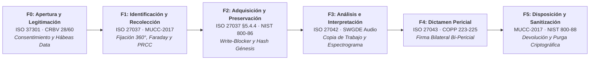

<div align="center">

# 🏛️ Forensic Chief Compliance Officer (FCCO) — SHA256.US

### *Plataforma Canónica de Cadena de Custodia, Peritaje Informático e Inmutabilidad Criptográfica*

[](https://github.com/julljoll/forensic-chief-compliance-officer/releases)
[](https://semver.org/)
[](https://astro.build/)
[](https://designsystem.digital.gov/)
[](https://php.net/)
[](https://tools.ietf.org/html/rfc6238)
[](https://tools.ietf.org/html/rfc8785)
[](LICENSE)

---

**Forensic Chief Compliance Officer (FCCO — SHA256.US)** es un sistema de gobernanza pericial, trazabilidad de evidencia digital y cumplimiento legal corporativo y penal. Proporciona a peritos informáticos, auditores, defensores y directores de cumplimiento un entorno riguroso para la sustanciación de pruebas electrónicas, garantizando la **inadulterabilidad técnica**, la **licitud probatoria** y la **admisibilidad en juicio** bajo los estándares internacionales más exigentes.

</div>

---

## 🎯 ¿Qué Problema Resuelve Este Proyecto?

En el derecho procesal moderno y en la auditoría forense corporativa, la **evidencia digital** (mensajería instantánea de WhatsApp/Telegram, registros de bases de datos SQLite, correos electrónicos, imágenes, grabaciones de voz y memorias volátiles) es el elemento probatorio más determinante, pero a la vez el más vulnerable: **es intangible, volátil y fácilmente alterable o impugnable con una mínima inconsistencia técnica**.

### 1. Nulidad Absoluta de Pruebas por Rotura de Cadena de Custodia
- **El Problema:** La mayoría de investigaciones periciales fracasan en tribunales no por falta de hallazgos técnicos, sino por **vicios en la cadena de custodia**. Si un dispositivo móvil es encendido sin aislamiento electromagnético (bolsa Faraday o modo avión), si no se utiliza un bloqueador de escritura (*hardware write-blocker*) al adquirir la evidencia, o si no se registra cada operario en la planilla de custodia, la contraparte promueve la **nulidad de la prueba por violación del debido proceso** (COPP Art. 181 y 187; Estándar Daubert / Federal Rules of Evidence 901/902).
- **La Solución FCCO:** El sistema implementa un **Ciclo Pericial en 6 Fases (F0 a F5)** regulado por compuertas criptográficas (*Cryptographic Gating*). Ningún perito puede saltarse pasos: el sistema exige registrar el aislamiento RF, el serial de precinto y la herramienta certificada antes de habilitar el sellado y cálculo del Hash Génesis SHA-256.

### 2. Vicios Formales y Desestimación de Actas y Dictámenes
- **El Problema:** Muchas actas y dictámenes periciales son emitidos en formatos heterogéneos de procesador de texto, sin foliado continuo, con márgenes inadecuados para encuadernación judicial, sin la identificación reglamentaria de dos peritos colegiados (exigida por el COPP Art. 223), sin recuadros dactiloscópicos reglamentarios (pulgar izquierdo y derecho) o con citas erróneas de tipos penales (ej. citar perjurio testimonial genérico en vez del falso testimonio pericial calificado de los Arts. 243 y 246 del Código Penal).
- **La Solución FCCO:** Proporciona un **catálogo unificado de 13 planillas y dictámenes oficiales** con tipografía y grilla de formularios federales de EE. UU. (**NIST SP 800-86 / FBI FD-1004 & FD-597 / OMB Control Block**), renderizadas con precisión milimétrica en **tamaño Folio/Oficio (216 mm × 330 mm)**, margen izquierdo de encuadernación de **30 mm**, casillas de verificación vectoriales nítidas, cajas de digest SHA-256 que nunca desbordan la página y firmas bilaterales con toma de huellas dactilares.

### 3. Mutabilidad y Manipulación de Bitácoras Tradicionales
- **El Problema:** En sistemas convencionales basados en bases de datos comunes, un administrador de TI o atacante puede modificar retroactivamente fechas, números de expediente o hashes de las tablas sin dejar rastro, destruyendo la confianza probatoria.
- **La Solución FCCO:** Implementa una **Cadena de Auditoría Criptográfica Inmutable (Hash Chain)** basada en serialización canónica RFC 8785 y SHA-256, respaldada por **triggers nativos a nivel de motor de base de datos** (`BEFORE UPDATE` y `BEFORE DELETE`) en MySQL/MariaDB que rechazan de forma determinante cualquier intento de edición o eliminación de registros históricos.

### 4. Sobrecarga y Fatiga Cognitiva del Compliance Officer
- **El Problema:** Los peritos y oficiales de cumplimiento enfrentan compendios de cientos de páginas de normativas dispersas (MUCC-2017, ISO 27037, ISO 27042, NIST, COPP, CRBV), lo que genera fatiga mental, omisión de controles y errores procedimentales involuntarios.
- **La Solución FCCO:** Diseñado bajo los principios de **UX/UI Minimalista de Panel de Control**, **Leyes de Gestalt** (Proximidad y Región Común), **Ley de Hick** y **Divulgación Progresiva (*Progressive Disclosure*)**. El flujo de trabajo se divide en **3 micro-pasos guiados por fase**:
  1. *Paso 1 — Datos Esenciales del Expediente:* Edición y guardado rápido contextual.
  2. *Paso 2 — Planillas Oficiales en Folio:* Acceso en 1 clic a formularios prellenados, en blanco para bolígrafo y exportación a Word (.docx).
  3. *Paso 3 — Validación Normativa RAG & Sello SHA-256:* Criterios en lenguaje natural con citas legales colapsadas que solo se despliegan bajo demanda.

### 5. Dependencia de Nubes Externas y Riesgo de Fuga de Evidencia
- **El Problema:** Muchas soluciones requieren subir metadatos confidenciales a servidores en la nube de terceros o APIs públicas, comprometiendo el secreto pericial, la cadena de custodia y los derechos constitucionales de Hábeas Data (CRBV Arts. 28 y 60).
- **La Solución FCCO:** Arquitectura **Offline-First e Independiente**. Opera completamente en navegadores de laboratorio mediante **IndexedDB** y sincroniza con servidores propios bajo **Apache + PHP 8.2 + MySQL (cPanel)**. La autenticación en dos factores (MFA) con **Google Authenticator (RFC 6238 TOTP)** y la generación de códigos QR se ejecutan **100 % localmente en el cliente**, sin transmitir jamás la semilla Base32 a servicios externos.

---

## 🏛️ Marco Jurídico y Estándares Técnicos Integrados

El sistema fue concebido para resistir el escrutinio pericial y judicial más severo, implementando el marco normativo canónico:

```
                                  ▲
                                 / \
                                /   \   1. CRBV Arts. 28, 48, 49 Ord. 5° y 60 (Hábeas Data y Debido Proceso)
                               /=====\
                              /       \  2. COPP Arts. 187 (Cadena Custodia) y 223–225 (Peritaje Colegiado)
                             /=========\
                            /           \ 3. MUCC-2017 (Gaceta Oficial N° 41.247 de Cadena de Custodia)
                           /=============\
                          /               \ 4. Ley de Mensajes de Datos y Firmas Electrónicas (LMDFE Arts. 4 y 7)
                         /=================\
                        /                   \ 5. ISO/IEC 27037:2012, 27042:2015, 27043:2015, ISO 37301 y 27001
                       /=====================\
                      /                       \ 6. NIST SP 800-86, SP 800-88 Rev. 1, SP 800-101 Rev. 1 y SWGDE
                     /=========================\
```

---

## 🔬 El Ciclo Pericial Canónico en 6 Fases (F0 a F5)

El sistema reemplaza las metodologías fragmentadas por un flujo continuo, secuencial y determinista:



| Fase | Denominación Canónica | Controles Clave de Conformidad | Planillas Oficiales Emitidas |
|:---:|:---|:---|:---|
| **F0** | **Apertura y Legitimación** | Legitimación del solicitante, delimitación estricta de alcance, autorización de acceso e intimación bajo juramento pericial (CP Arts. 243 y 246). | `FO-F0-01` (Consentimiento Informado)<br/>`FO-F0-02` (Entrevista al Consignante) |
| **F1** | **Identificación y Recolección** | Fijación fotográfica 360°, aislamiento electromagnético (Bolsa Faraday y Modo Avión), precintado de seguridad y apertura de la matriz PRCC. | `FO-F1-03` (Acta de Obtención y Preservación)<br/>`FO-PRCC-01` (Planilla PRCC Anverso) |
| **F2** | **Adquisición y Preservación** | Desprecintado en ambiente controlado de laboratorio, uso de bloqueadores de escritura (Tableau), extracción lógica/física (FTK/ALEAPP) y cálculo del Hash Génesis SHA-256. | `FO-F2-05` (Acta de Desprecintado)<br/>`FO-PRCC-01` (Planilla PRCC Reverso) |
| **F3** | **Análisis e Interpretación** | Trabajo exclusivo sobre copia forense, reproducibilidad científica, análisis acústico FFT de notas de voz WhatsApp (48 kHz Opus) y cotejo de correspondencia UX pantalla-base de datos. | `FO-F3-06` (Análisis de Audio y Espectrograma)<br/>`FO-F3-07` (Evaluación de Interfaz UX) |
| **F4** | **Informe Pericial y Dictamen** | Redacción motivada de conclusiones con cita de hashes génesis, fundamentos técnicos y firma bilateral simultánea de dos peritos colegiados (CIV / INPRE). | `FO-F4-08` (Dictamen Pericial Oficial)<br/>`FO-F4-09` (Dictamen de Imágenes)<br/>`FO-F4-10` (Dictamen de Audios) |
| **F5** | **Entrega, Disposición y Sanitización** | Disposición final reglamentaria MUCC (devolución, entrega, destrucción o consumida), sanitización de discos del laboratorio (NIST SP 800-88) y auditoría total. | `FO-F5-11` (Acta de Entrega de Resultados)<br/>`FO-F5-12` (Acta de Sanitización Criptográfica)<br/>`FO-F5-13` (Acta de Auditoría y Timeline) |

---

## 📜 Catálogo Oficial de 13 Planillas Forenses en Tamaño Folio (216mm × 330mm)

Todas las planillas están estrictamente encapsuladas en `<div class="folio-forense-aislado">` con estilos independientes (`src/styles/folio-aislado.css`), sin herencia de clases de pantalla que contaminen la impresión:

```
┌────────────────────────────────────────────────────────────────────────┐
│ [LOGO] REPÚBLICA BOLIVARIANA DE VENEZUELA   │ FORMULARIO: FO-PRCC-01   │
│        LABORATORIO DE INFORMÁTICA FORENSE   │ REV: 2026-11             │
│        DIVISIÓN PERICIAL SHA256.US          │ AUTORIDAD: COPP ART. 187 │
├─────────────────────────────────────────────┴──────────────────────────┤
│ PLANILLA DE REGISTRO DE CADENA DE CUSTODIA (MUCC-2017)                 │
├────────────────────────────────────────────────────────────────────────┤
│ 1. EXPEDIENTE N°: EXP-2026-0042        │ 2. PRCC N°: PRCC-2026-0089    │
├────────────────────────────────────────┴───────────────────────────────┤
│ [■] Margen Izquierdo de Costura: 30 mm                                  │
│ [■] Casillas de Verificación Vectoriales CSS: [✓] [✕]                  │
│ [■] Hash SHA-256 no truncado (overflow-wrap: break-word)               │
│ [■] Firma Bilateral + C.I. + CIV/INPRE + Dactiloscopía Bilateral      │
│     (PULGAR IZQUIERDO: 18x24mm | PULGAR DERECHO: 18x24mm)              │
└────────────────────────────────────────────────────────────────────────┘
```

1. **`FO-F0-01` — Acta de Consentimiento Informado y Delimitación de Hábeas Data:** CRBV Arts. 28, 48, 60; LEDCI Arts. 20–22; ISO/IEC 27037.
2. **`FO-F0-02` — Acta de Entrevista Técnico-Pericial al Consignante:** MUCC-2017; CRBV Art. 49 Ord. 5°; CP Arts. 243 y 246; ISO/IEC 27042.
3. **`FO-F1-03` — Acta de Obtención por Consignación y Preservación de Evidencias:** MUCC-2017 Modalidad Consignación; COPP Art. 187; ISO/IEC 27037 §5.4.2–5.4.3.
4. **`FO-PRCC-01` — Planilla de Registro de Cadena de Custodia (PRCC):** 8 campos iniciales reglamentarios, anverso de fijación/colección y reverso con matriz de 5 motivos de transferencia formal (MUCC-2017 y COPP Art. 187).
5. **`FO-F2-05` — Acta de Desprecintado y Adquisición Lógica en Laboratorio:** ISO/IEC 27037 §5.4.4 y §7.1.3; NIST SP 800-101 Nivel 2; COPP Art. 187.
6. **`FO-F3-06` — Planilla de Análisis Acústico Forense y Espectrograma:** LMDFE Arts. 4 y 7; Ley sobre Privacidad de las Comunicaciones Art. 2; ISO/IEC 27042; SWGDE.
7. **`FO-F3-07` — Planilla de Evaluación Pericial de Interfaz UX y Calidad de Software:** ISO/IEC 25010; ISO/IEC 27042 §8; LMDFE Art. 4.
8. **`FO-F4-08` — Dictamen Pericial Oficial Colegiado de Informática Forense:** COPP Arts. 187, 223–225; LMDFE Arts. 4 y 7; CENIF (G.O. 39.847 Art. 2.1).
9. **`FO-F4-09` — Dictamen Pericial Especializado en Evidencia Fotográfica Digital:** COPP Arts. 223–225; LMDFE Arts. 4 y 7; ISO/IEC 27042 (Análisis ELA y metadatos EXIF).
10. **`FO-F4-10` — Dictamen Pericial Especializado en Notas de Voz y Audio Digital:** COPP Arts. 223–225; LMDFE Arts. 4 y 7; CENIF; SWGDE Audio.
11. **`FO-F5-11` — Acta de Disposición Final y Entrega Formal de Resultados:** 4 modalidades MUCC-2017 (Devolución, Entrega, Destrucción, Consumida en peritaje); COPP Art. 187.
12. **`FO-F5-12` — Acta de Sanitización Criptográfica y Destrucción Segura de Medios:** NIST SP 800-88 Rev. 1 (Técnicas Clear, Purge y Destroy); ISO/IEC 27001; CRBV Art. 60.
13. **`FO-F5-13` — Acta de Auditoría y Trazabilidad Criptográfica Inmutable:** ISO/IEC 27037; LMDFE Arts. 4, 7 y 16; Cadena de Bloques SHA-256 (RFC 8785).

---

## 🔒 Arquitectura de Seguridad y Criptografía

El sistema cumple con un catálogo estricto de 10 vectores de endurecimiento (**SEC-01 a SEC-10**):

| Código | Vector de Seguridad | Implementación Técnica |
|:---:|:---|:---|
| **SEC-01** | **MFA TOTP Obligatorio** | Cumplimiento estricto de RFC 6238 con secretos Base32 (`20 bytes / 32 chars`), ventana de deriva `±1 paso` (30s) y prevención de replay attacks guardando el último `timestamp_step` consumido. |
| **SEC-02** | **Códigos de Recuperación** | Generación de 8 códigos de emergencia criptográficos de 10 caracteres alfanuméricos almacenados con hash seguro `password_hash()` para contingencias. |
| **SEC-03** | **Enrolamiento QR 100% Offline** | Renderizado del código QR de autenticación directamente en el DOM mediante SVG/Canvas local (`qrcode`), eliminando cualquier llamada a APIs de terceros (ej. Google Charts API). |
| **SEC-04** | **Triggers de Inmutabilidad** | Triggers MySQL `trg_auditoria_no_update` y `trg_auditoria_no_delete` que abortan con `SIGNAL SQLSTATE '45000'` ante cualquier intento de alteración de bitácoras. |
| **SEC-05** | **Mitigación de Timing Attacks** | Ejecución de `password_verify()` contra un hash bcrypt señuelo en caso de usuario inexistente, garantizando tiempo constante de respuesta frente a ataques de enumeración. |
| **SEC-06** | **Protección CSRF y Rate-Limiting** | Tokens criptográficos `X-CSRF-Token` por sesión para mutaciones y bloqueo temporal ante fuerza bruta (máximo 5 intentos fallidos por ventana de 15 minutos). |
| **SEC-07** | **Saneamiento de Base de Datos** | Contraseñas y secretos quemados eliminados de archivos fuente y scripts; reemplazados por credenciales seguras vía `config.local.php`. |
| **SEC-08** | **Protección Apache (.htaccess)** | Bloqueo absoluto de acceso web directo a `api/lib/`, archivos `.sql`, `.env` y `.log`; cabeceras estrictas `X-Frame-Options: SAMEORIGIN`, `X-Content-Type-Options: nosniff` y CSP. |
| **SEC-09** | **Cadena de Hashes SHA-256** | Serialización canónica determinista de objetos bajo el estándar RFC 8785 garantizando paridad matemática exacta de hashes entre PHP, TypeScript y Node.js. |
| **SEC-10** | **Cierre por Inactividad** | Temporizador en cliente que advierte a los 25 minutos y destruye la sesión a los 30 minutos de inactividad, evitando accesos no autorizados en terminales de laboratorio. |

---

## 💻 Stack Tecnológico Exclusivo

- **Generador Estático:** **Astro (`output: 'static'`)** — Genera 23 páginas HTML ultra-rápidas y optimizadas para SEO y seguridad.
- **Sistema de UI y Componentes:** **U.S. Web Design System (`@uswds/uswds` 3.14)** compilado con Sass a `public/assets/uswds/css/uswds.min.css`.
- **Backend Determinista para Hosting:** **PHP 8.2+ con PDO** conectado a **MySQL/MariaDB** (`public/api/`).
- **Persistencia Híbrida:** **IndexedDB** en el navegador para operación 100% offline y sincronización con MySQL vía API REST.
- **Tipografía Institucional:**
  - `Public Sans Web` (Interfaz general y formularios USWDS).
  - `Merriweather Web` (Títulos formales y decretos periciales).
  - `Roboto Mono Web` (Digests SHA-256, números de causa, precintos y seriales).
- **Prohibiciones Cumplidas:** Cero utilidades de Tailwind CSS, cero componentes de Material-UI (MUI), cero dependencias de ejecución de React en páginas estáticas.

---

## 🚀 Guía de Instalación y Despliegue en cPanel

### 1. Requisitos Previos en el Entorno de Desarrollo
- Node.js 18+ LTS y npm.
- Servidor web Apache con PHP 8.2+ (extensiones `pdo_mysql`, `openssl`, `mbstring`) y MySQL 5.7+ / MariaDB 10.3+.

### 2. Compilación del Proyecto
```bash
# Clonar el repositorio
git clone https://github.com/julljoll/forensic-chief-compliance-officer.git
cd forensic-chief-compliance-officer

# Instalar dependencias exactas
npm ci

# Ejecutar suite de pruebas de calidad
npm test

# Compilar activos de producción
npm run build
```
El comando `npm run build` compila los estilos USWDS, ejecuta Astro static y el script `postbuild.mjs`, dejando todo el sitio listo en el directorio `dist/`.

### 3. Configuración en cPanel / Servidor Web
1. **Importar Base de Datos:**
   - En **phpMyAdmin**, seleccionar la base de datos creada e importar [`database.sql`](file:///home/antigravity/julljoll/forensic-chief-compliance-officer/database.sql).
2. **Configurar Credenciales:**
   - Copiar `public/api/config.example.php` como `dist/api/config.local.php` (o en `public_html/api/config.local.php` en el servidor) y colocar las credenciales de conexión:
   ```php
   <?php
   define('DB_HOST', 'localhost');
   define('DB_NAME', 'tu_base_datos');
   define('DB_USER', 'tu_usuario_mysql');
   define('DB_PASS', 'TuClaveSegura2026!');
   define('DB_CHARSET', 'utf8mb4');
   ```
3. **Subir Archivos a `public_html`:**
   - Subir el contenido de la carpeta `dist/` directamente a la raíz web (`public_html/`).
   - Asegurarse de que el archivo `.htaccess` esté visible en la raíz de `public_html`.

---

## 🧪 Pruebas Automatizadas de Rigor Pericial

El proyecto incluye 72 pruebas automatizadas distribuidas en 12 suites de Vitest:

```bash
npm test
```

- `tests/unit/planillas/legalCompliance.test.ts`: Valida que las citas legales de las 13 planillas coincidan exactamente con la legislación pericial (CP Arts. 243 y 246, ISO/IEC 27037 §5.4.4, MUCC-2017).
- `tests/unit/planillas/paridad.test.ts`: Valida la presencia de las 13 planillas y la correspondencia de campos en Folio.
- `tests/unit/crypto/canonical.test.ts`: Valida que la serialización JSON canónica cumpla con RFC 8785 y los vectores de prueba de hashes SHA-256.
- `tests/unit/crypto/totp.test.ts`: Valida el generador y verificador RFC 6238 Base32, mitigación de replay y códigos de recuperación.
- `tests/unit/domain/gating.test.ts`: Valida que las compuertas criptográficas impidan avanzar de fase sin los controles completos.
- `tests/unit/build/distVerification.test.ts`: Valida la integridad del paquete generado en `dist/` para despliegue en cPanel.

---

## 🏛️ Créditos y Licencia

Desarrollado para el **Laboratorio de Informática Forense SHA256.US**, bajo la dirección de cumplimiento y peritaje del Compliance Officer y Perito Informático Colegiado.

Distribuido bajo la **Licencia MIT**. Consulte el archivo [LICENSE](file:///home/antigravity/julljoll/forensic-chief-compliance-officer/LICENSE) para más detalles.
