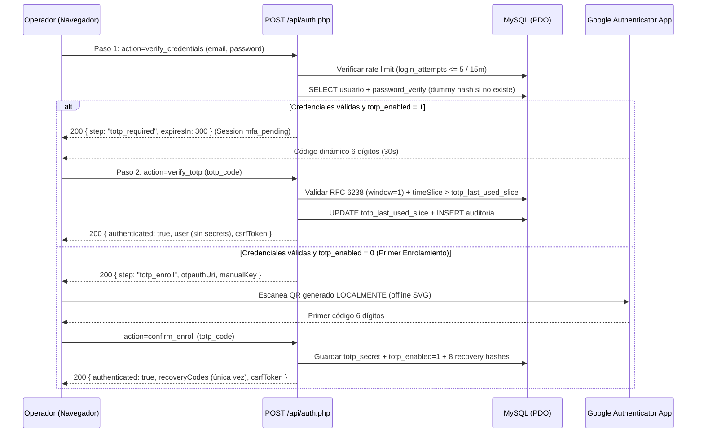

# 🏛️ Plan Maestro de Optimización Forense, UX/UI y Seguridad — SHA256.US (FCCO)

> [!IMPORTANT]
> **Manual Operativo de Ejecución para Gemini 3.8 Flash (Modo Etapa por Etapa)**
> Este plan está estructurado como un **runbook determinista de 8 etapas (Etapa 0 → Etapa 7)** con compuertas de verificación obligatorias. El modelo ejecutor **DEBE ejecutar UNA sola etapa por turno**, verificar todos los comandos de compuerta (*Stage Gate*) y **NO avanzar a la siguiente etapa** hasta que el 100 % de los criterios de aceptación estén en verde.

---

## 0. Reglas Inquebrantables de Gobernanza (Leer al Inicio de CADA Etapa)

| Regla | Mandato Estricto (ENFORCED) | Prohibición Explícita |
|:------|:----------------------------|:----------------------|
| **Framework** | **Astro (`output: 'static'`)** compilado a `dist/` para cPanel (Apache + PHP 8.2+ + MySQL PDO). | **PROHIBIDO** Next.js, Material-UI (MUI), Tailwind CSS o dependencias React fuera de `src/lib/pdf/**`. |
| **Sistema de Diseño** | **`@uswds/uswds` 3.14+** compilado vía `src/styles/uswds-theme.scss` → `public/assets/uswds/css/uswds.min.css`. | **PROHIBIDO** inventar frameworks CSS paralelos, utilidades Tailwind o estilos inline repetitivos en vistas del CMS. |
| **Contenido Legal de Planillas** | **PRESERVAR ÍNTEGRAMENTE** el texto jurídico de las 13 planillas. Aplicar **ÚNICAMENTE** las correcciones puntuales listadas en la **Etapa 4** (justificadas con cita textual de la carpeta `RAG/`). | **PROHIBIDO** parafrasear, acortar o reescribir cláusulas legales que no tengan incongruencia documentada en la Tabla A. |
| **Formato Físico de Impresión** | **Folio / Oficio Judicial (`216mm × 330mm`)** encapsulado en `.folio-forense-aislado` (`src/styles/folio-aislado.css`), márgenes `15mm 15mm 15mm 30mm` (30 mm izquierdo para costura judicial). | **PROHIBIDO** cambiar el tamaño físico a Letter/A4 o romper el aislamiento CSS respecto al shell USWDS. |
| **Seguridad TOTP / Login** | MFA real de 2 pasos (Contraseña + Google Authenticator RFC 6238) validado **100 % en PHP servidor**. QR generado **localmente offline** (SVG/Canvas). | **PROHIBIDO** exponer secretos TOTP o contraseñas en HTML/JS cliente, mantener bypass offline de login o enviar el secreto TOTP a APIs externas de QR. |
| **Paridad de Rutas cPanel** | Mantener exactas todas las URLs existentes (`/`, `/dashboard`, `/casos`, `/flujo`, `/custodia`, `/planillas`, `/planillas/[slug]`, `/normativa`, `/auditoria`, `/exportar`). | **PROHIBIDO** renombrar rutas estáticas verificadas por `tests/unit/build/distVerification.test.ts`. |

```mermaid
flowchart LR
    E0["Etapa 0: Baseline y Rama"] --> E1["Etapa 1: Nuevos Logos y Activos"]
    E1 --> E2["Etapa 2: Componentes Astro + Footer/Header UX"]
    E2 --> E3["Etapa 3: Hardening Login + MFA Google Auth"]
    E3 --> E4["Etapa 4: Corrección Legal/Estructural RAG (13 Planillas)"]
    E4 --> E5["Etapa 5: Diseño de Impresión Estándar EE.UU. + USWDS"]
    E5 --> E6["Etapa 6: Flujo Cognitivo RAG F0-F5 y Dashboard UX"]
    E6 --> E7["Etapa 7: QA, Tests, Build cPanel y Auditoría Final"]
```



---

## 1. Diagnóstico Verificado del Repositorio (Evidencia Base)

### Tabla A — Incongruencias Legales y Estructurales Verificadas contra `RAG/Informacion_docling_rag/`

Solo estos hallazgos autorizan edición de contenido/estructura en las 13 planillas:

| ID | Archivo(s) Afectado(s) | Texto / Estructura Actual | Evidencia Exacta en `RAG/Informacion_docling_rag/` | Corrección Quirúrgica Obligatoria |
|:---|:-----------------------|:--------------------------|:---------------------------------------------------|:----------------------------------|
| **LEG-01** | [ActaEntrevista.astro](file:///home/antigravity/julljoll/forensic-chief-compliance-officer/src/components/planillas/ActaEntrevista.astro#L4-L148), [planillas/index.astro](file:///home/antigravity/julljoll/forensic-chief-compliance-officer/src/pages/planillas/index.astro#L24) | Cita **`Código Penal Art. 242`** para el delito de *falso testimonio*. | `Penal/codigo penal.md` L1800–L1845: **Art. 242** regula rebaja de pena por retractación de calumnia; el **falso testimonio** es el **Art. 243** (*Capítulo IV: Del falso testimonio*) y su extensión a **expertos e intérpretes** es el **Art. 246**. | Sustituir `CP Art. 242` → **`CP Art. 243`** (y añadir mención concordante a `Art. 246` para expertos) sin alterar el resto de la cláusula. |
| **LEG-02** | [ActaConsentimiento.astro](file:///home/antigravity/julljoll/forensic-chief-compliance-officer/src/components/planillas/ActaConsentimiento.astro#L91), [ActaDesprecintado.astro](file:///home/antigravity/julljoll/forensic-chief-compliance-officer/src/components/planillas/ActaDesprecintado.astro#L4-L33), [ActaDictamen.astro](file:///home/antigravity/julljoll/forensic-chief-compliance-officer/src/components/planillas/ActaDictamen.astro#L5-L110), [planillas/index.astro](file:///home/antigravity/julljoll/forensic-chief-compliance-officer/src/pages/planillas/index.astro#L48), [fases-iso.json](file:///home/antigravity/julljoll/forensic-chief-compliance-officer/src/data/fases-iso.json#L74), [tiposProyecto.ts](file:///home/antigravity/julljoll/forensic-chief-compliance-officer/src/data/tiposProyecto.ts#L667) | Citan **`ISO/IEC 27037 §5.4.3`** como *"Adquisición lógica forense / Verificación de adquisición"*. | `Informatica/ISO IEC 27037-2012.md` TOC L88–L93 y L115–L121: `§5.4.2` = *Identification*, **`§5.4.3` = *Collection*** (NO Adquisición), **`§5.4.4` = *Acquisition***, `§5.4.5` = *Preservation*, `§7.1.3` = *Acquisition*. | Sustituir `ISO/IEC 27037 §5.4.3` → **`ISO/IEC 27037 §5.4.4 / §7.1.3`** donde se refiere a adquisición. |
| **LEG-03** | [ActaObtencion.astro](file:///home/antigravity/julljoll/forensic-chief-compliance-officer/src/components/planillas/ActaObtencion.astro#L4-L94) | Cita `ISO/IEC 27037 §5.3` para *"Identificación técnica del dispositivo móvil"* y rotula el acta como *"MUCC-2017 Modelo 3"*. | `ISO IEC 27037-2012.md` L82–L93: `§5.3` son *Requirements (Auditability, Repeatability, Reproducibility)*; Identificación es **`§5.4.2 / §7.1.1`** y Recolección/Preservación **`§5.4.3 / §5.4.5`**. En `MANUAL_ÚNICO_DE_CADENA...md` L1678 y L2527 el acta oficial se denomina *Acta de Obtención por Consignación* (3ª forma de obtención). | Corregir `§5.3` → **`§5.4.2 / §5.4.3`** en identificación/obtención y precisar `MUCC-2017 (Acta de Obtención por Consignación · G.O. 41.247)`. |
| **EST-01** | [PlanillaPRCC.astro](file:///home/antigravity/julljoll/forensic-chief-compliance-officer/src/components/planillas/PlanillaPRCC.astro#L46-L244) | Faltan campos reglamentarios obligatorios de la PRCC oficial. | `MANUAL_ÚNICO_DE_CADENA...md` L1918–L2330 (*Estructura e Instructivo PRCC*): exige **(I)** 8 campos separados (`Expediente/Causa`, `N° PRCC`, `Despacho que instruye`, `Organismo que instruye`, `Despacho que inicia custodia`, `Organismo que custodia`, `Dirección de obtención`, `Fecha y Hora DD/MM/AAAA`); **(III)** recuadro de **Pulgar Derecho** en A. Fijación y B. Colección; **(IV)** casilla `Continuación: [ ] Sí (Anexo A) [ ] No`; **(V)** Motivos numerados (`1. Traslado`, `2. Peritaje`, `3. Resguardo`, `4. Disposición Judicial`, `5. Disposición Final`), `N° de Comunicación`, `Organismo` y `Despacho` de Entrega/Recibe, **Pulgar Derecho** en entrega/recibe, `Observaciones`, y **Nota obligatoria de permanencia en original** (L2018). | Incorporar los campos y casillas faltantes en `PlanillaPRCC.astro` (manteniendo sus 2 hojas Folio y preservando el texto vigente). |
| **EST-02** | [ActaObtencion.astro](file:///home/antigravity/julljoll/forensic-chief-compliance-officer/src/components/planillas/ActaObtencion.astro#L45-L242) y [ActaEntregaResultados.astro](file:///home/antigravity/julljoll/forensic-chief-compliance-officer/src/components/planillas/ActaEntregaResultados.astro#L38-L127) | Faltan campos de los Modelos de Actas MUCC-2017. | `MANUAL_ÚNICO_DE_CADENA...md` L2527–L2584 (*Obtención por Consignación*): exige `Organismo`, `Oficina que instruye`, casilla `Continuación Sí/No`, bloque de `Observaciones`, identificación con **Pulgar Derecho** de `Colección-Recepción` y `Fijación` además del `Consignante`, y nota de archivo en expediente (L2583). L2653–L2700 (*Disposición Final*): exige las **4 formas reglamentarias** (`Devolución`, `Entrega`, `Destrucción`, `Consumida` — hoy solo hay 2), `Organismo`, `Oficina que instruye`, `Descripción del Proceso de Cierre`, `Observaciones` y nota de cierre (L2699). | Añadir las 4 modalidades de Disposición Final y los bloques/notas reglamentarios faltantes sin alterar las cláusulas existentes. |
| **EST-03** | [ActaDictamen.astro](file:///home/antigravity/julljoll/forensic-chief-compliance-officer/src/components/planillas/ActaDictamen.astro#L46-L115), [DictamenImagenes.astro](file:///home/antigravity/julljoll/forensic-chief-compliance-officer/src/components/planillas/DictamenImagenes.astro#L38-L57), [DictamenAudios.astro](file:///home/antigravity/julljoll/forensic-chief-compliance-officer/src/components/planillas/DictamenAudios.astro#L39-L57) | Falta recuadro explícito **"Motivo / Objeto del Peritaje"** (y estado físico/lógico inicial). | COPP vigente Art. 225 (texto idéntico al Art. 239 en `Penal/codigo-organico-procesal-penal.md` L3515): el dictamen pericial **deberá contener**: *(1) motivo por el cual se practica, (2) descripción de la persona o cosa en el estado en que se halle, (3) relación detallada de exámenes, (4) resultados obtenidos, (5) conclusiones*. | Agregar recuadro estructurado `Motivo del Peritaje y Estado Inicial de la Evidencia` en la sección 1.0/2.0 de los 3 dictámenes. |
| **EST-04** | [PlanillaAudioSonic.astro](file:///home/antigravity/julljoll/forensic-chief-compliance-officer/src/components/planillas/PlanillaAudioSonic.astro#L28) vs [DictamenAudios.astro](file:///home/antigravity/julljoll/forensic-chief-compliance-officer/src/components/planillas/DictamenAudios.astro#L29) + [planillasRegistry.ts](file:///home/antigravity/julljoll/forensic-chief-compliance-officer/src/data/planillasRegistry.ts) | **Colisión de código documental**: ambas planillas usan `codigoDoc="FO-AUD-01"`. Además `planillasRegistry.ts` usa códigos obsoletos (`FO-SHA256-ACT-001`) y cita `COPP Art. 186`. | Control documental ISO/IEC 17025 / ISO 37301 exige código único trazable por formulario. COPP vigente (citado por MUCC-2017 L531) es **Art. 187** (no 186). | Unificar códigos únicos en `planillasRegistry.ts` y propagarlos a las 13 planillas (`FO-AUD-01` para Planilla Audio F3; `FO-DIC-AUD-01` para Dictamen Audios F4; `FO-DIC-IMG-01` para Dictamen Imágenes F4). |
| **EST-05** | [PlanillaFirmasBilaterales.astro](file:///home/antigravity/julljoll/forensic-chief-compliance-officer/src/components/planillas/PlanillaFirmasBilaterales.astro#L44-L111) | (1) Imprime `"Firma del Consignante / Solicitante"` en **8 planillas bi-periciales** donde ambos firmantes son peritos; (2) asigna `data-field="solicitante_*"` al Perito Principal, causando que `bindPlanilla.ts` sobrescriba al Perito con datos del cliente en `?modo=datos`; (3) omite `CIV / INPRE` del Perito Principal (exigido por COPP Art. 224); (4) invierte el orden ergonómico de pulgares (`DER.` izquierda / `IZQ.` derecha). | COPP Art. 224 (título habilitante del perito) · MUCC-2017 (identificación unívoca de intervinientes) · `.agents/AGENTS.md` §4 (cierre legal bilateral). | Añadir prop `leftRole?: 'consignante' \| 'perito'` y `leftLegend` / `rightLegend`; usar `data-field="perito_*"` + `CIV/INPRE` cuando `leftRole="perito"`; corregir orden visual **`PULGAR IZQ.`** (izquierda) \| **`PULGAR DER.`** (derecha). |
| **EST-06** | [ActaAuditoriaTimeline.astro](file:///home/antigravity/julljoll/forensic-chief-compliance-officer/src/components/planillas/ActaAuditoriaTimeline.astro#L20-L27) | `DEFAULT_LOGS` incluye hashes sintéticos (`d1028491824912...` y hash de cadena vacía `e3b0c442...`) en lugar de consultar los registros reales de auditoría del caso. | ISO/IEC 27001 A.8.15 · LMDFE Art. 7 (integridad verificable real). | Hidratar filas reales vía `bindPlanilla.ts` llamando a `phpApi.listarAuditoria(casoId)` y renderizar fila vacía de control si no existen logs aún. |
| **EST-07** | [folio-aislado.css](file:///home/antigravity/julljoll/forensic-chief-compliance-officer/src/styles/folio-aislado.css#L9-L100) | Aplica `padding: 15mm 12mm 15mm 25mm` (25 mm izq.) en lugar del margen reglamentario `15mm 15mm 15mm 30mm` (30 mm izq. de encuadernación judicial) exigido en `.agents/AGENTS.md` §4. | `.agents/AGENTS.md` §4: `@page { size: 216mm 330mm; margin: 15mm 15mm 15mm 30mm; }`. | Normalizar padding de `.page` a `15mm 15mm 15mm 30mm` (con `@page { size: 216mm 330mm; margin: 0; }` para evitar doble margen en motores Chromium/WebKit) y validar que las 13 planillas encajen sin desborde vertical (`<= 330mm`). |

> [!NOTE]
> **Aclaración de Gobernanza RAG sobre el COPP:** Los archivos `RAG/Informacion_docling_rag/Penal/codigo-organico-procesal-penal.md` y `codigo organico procesal penal.md` corresponden a ediciones anteriores del COPP (donde Experticias eran Arts. 237–239). La legislación venezolana vigente (COPP 2012/2021), **citada textualmente por el propio `MUCC-2017` en la carpeta `RAG/Informatica` (L531 y L1522)**, consagra la Cadena de Custodia en el **Art. 187**, Áreas de Resguardo en el **Art. 188**, y Experticias/Peritos/Dictamen en los **Arts. 223–225**. Por lo tanto, **NO se deben cambiar** las citas `COPP Arts. 187, 223–225` en las planillas (son jurídicamente vigentes y exactas).

---

### Tabla B — Vulnerabilidades de Seguridad Verificadas en Login, Sesiones y API PHP

| Sev. | ID | Ubicación Exacta | Vulnerabilidad Detectada | Remediación Obligatoria (Etapa 3) |
|:-----|:---|:-----------------|:-------------------------|:----------------------------------|
| 🔴 **CRÍTICA** | **SEC-01** | [index.astro](file:///home/antigravity/julljoll/forensic-chief-compliance-officer/src/pages/index.astro#L196-L208) | **Secretos TOTP de producción impresos en texto plano en la página pública de login** (`JULLJOLLFCCO2FA1`, `SHA256USFCCO2FA2`). | Eliminar completamente el bloque HTML de secretos. Mostrar QR/clave de enrolamiento **solo tras autenticar Factor 1** y solo si `totp_enabled = 0`. |
| 🔴 **CRÍTICA** | **SEC-02** | [authStore.ts](file:///home/antigravity/julljoll/forensic-chief-compliance-officer/src/store/authStore.ts#L34-L120), [index.astro](file:///home/antigravity/julljoll/forensic-chief-compliance-officer/src/pages/index.astro#L317-L321) | **Contraseñas en texto plano (`Karupano`, `admin`, `15816003`) y secretos TOTP embebidos en el bundle JS cliente**, más fallback cliente que **bypasea un `401` del servidor**. | Eliminar 100 % de credenciales y lógica de verificación cliente en `authStore.ts`; eliminar el fallback local en `LoginView.astro`. Toda autenticación ocurre únicamente en `POST /api/auth.php`. |
| 🔴 **CRÍTICA** | **SEC-03** | [casos.php](file:///home/antigravity/julljoll/forensic-chief-compliance-officer/public/api/casos.php#L19), [avanzar-etapa.php](file:///home/antigravity/julljoll/forensic-chief-compliance-officer/public/api/avanzar-etapa.php#L31), [auditoria.php](file:///home/antigravity/julljoll/forensic-chief-compliance-officer/public/api/auditoria.php#L105) | **Ausencia total de control de acceso en la API**: `Session::requireUser()` nunca se invoca; cualquier atacante anónimo puede leer/modificar expedientes, avanzar etapas ISO e inyectar logs falsos como `'perito@sha256.us'`. | Llamar a `$user = Session::requireUser();` al inicio de `casos.php`, `avanzar-etapa.php` y `auditoria.php` (y eliminar todo fallback `'perito@sha256.us'`). |
| 🔴 **CRÍTICA** | **SEC-04** | [lib/auth.php](file:///home/antigravity/julljoll/forensic-chief-compliance-officer/public/api/lib/auth.php#L72-L111) | (1) **Fuga de `totp_secret` en respuesta JSON y `$_SESSION`** (solo hace `unset($row['password_hash'])`); (2) **secretos TOTP de respaldo hardcodeados**; (3) **Single-Factor Bypass** (permite entrar con solo contraseña sin 2FA o solo TOTP); (4) **TOTP Replay** (permite reusar un código válido durante 90 s). | Eliminar fallbacks hardcodeados; `unset($row['password_hash'], $row['totp_secret'], $row['totp_last_used_slice'], $row['totp_recovery_hashes'])`; imponer **MFA 2 pasos (Contraseña + TOTP)**; guardar `totp_last_used_slice` para bloquear replay. |
| 🔴 **CRÍTICA** | **SEC-05** | [config.php](file:///home/antigravity/julljoll/forensic-chief-compliance-officer/public/api/config.php#L17), [database.sql](file:///home/antigravity/julljoll/forensic-chief-compliance-officer/database.sql#L141-L167), [lib/db.php](file:///home/antigravity/julljoll/forensic-chief-compliance-officer/public/api/lib/db.php#L44) | Credenciales reales de MySQL (`sirixutr_julljoll` / `Karupano15*`) commiteadas en Git, claves en comentarios SQL y fuga de `$e->getMessage()` en errores HTTP 503. | Cargar credenciales desde variables de entorno cPanel (`SetEnv`) o `config.local.php` (ignorado en `.gitignore`), crear `config.example.php`, limpiar comentarios con claves en `database.sql` y loguear errores PDO con `error_log()` sin exponer detalles al cliente. |
| 🟠 **ALTA** | **SEC-06** | [lib/totp.php](file:///home/antigravity/julljoll/forensic-chief-compliance-officer/public/api/lib/totp.php#L15-L90) | Secretos actuales (`JULLJOLLFCCO2FA1`) contienen caracteres inválidos en RFC 4648 Base32 (`'1'`) que se ignoran silenciosamente y tienen baja entropía (~75 bits vs 160 bits requeridos por RFC 6238 / NIST SP 800-63B). | Validar Base32 estricto (`^[A-Z2-7]+=*$`), añadir `Totp::generateSecret(20)` (160 bits con `random_bytes(20)` → 32 chars Base32), `Totp::buildProvisioningUri()`, y `Totp::verifyAndGetSlice()` en tiempo constante. |
| 🟠 **ALTA** | **SEC-07** | [auth.php](file:///home/antigravity/julljoll/forensic-chief-compliance-officer/public/api/auth.php) | **Sin Rate Limiting / Bloqueo de Fuerza Bruta** (un código TOTP de 6 dígitos solo tiene $10^6$ combinaciones) y **oráculo de enumeración por tiempo** en emails inexistentes. | Tabla `login_attempts` en MySQL (máx. 5 fallos / 15 min por IP+email → HTTP `429 Retry-After`); ejecutar `password_verify()` contra un hash dummy cuando el email no exista. |
| 🟠 **ALTA** | **SEC-08** | Todos los endpoints `POST`/`PUT`/`DELETE` + [phpApi.ts](file:///home/antigravity/julljoll/forensic-chief-compliance-officer/src/lib/data/phpApi.ts) | **Sin protección CSRF** en mutaciones de sesión autenticada. | Emitir `csrf_token` (`bin2hex(random_bytes(32))`) en `GET/POST /api/auth.php`, validarlo vía cabecera `X-CSRF-Token` con `hash_equals()` + verificación de `Origin`/`Referer` en todas las mutaciones. |
| 🟠 **ALTA** | **SEC-09** | [AppLayout.astro](file:///home/antigravity/julljoll/forensic-chief-compliance-officer/src/layouts/AppLayout.astro#L153-L299) | **Sin guardia de sesión en páginas protegidas** y usuario hardcodeado `"Perito: Jull Joll (FCCO)"` en el header. | Crear `AuthGuard.astro` que consulta `GET /api/auth.php`, redirige a `/` en `401`, hidrata el nombre/rol real del operador en `SiteHeader.astro`, e implementa cierre por inactividad (30 min). |
| 🟡 **MEDIA** | **SEC-10** | [public/.htaccess](file:///home/antigravity/julljoll/forensic-chief-compliance-officer/public/.htaccess) | Permite solicitar directamente `/api/lib/*.php`, carece de `Content-Security-Policy` y usa `SameSite=Lax`. | Bloquear `^api/lib/` con `[F,L]`, agregar `Content-Security-Policy` estricta (`default-src 'self'`), cambiar cookie a `SameSite=Strict` + `session.use_strict_mode=1` + timeout inactividad 30 min / absoluto 8 h. |

---

### Tabla C — Activos de Marca Adjuntos y Diagnóstico UX/UI

- **Logos nuevos adjuntos (checksums verificados ≠ actuales en `public/`):**
  - `/home/antigravity/logo(1).png` (`100×100` RGBA, círculo dorado `#F9C600`/`#FFBE2E` con `"sha"` azul marino `#112E51` y `"256"` blanco `#FFFFFF`) → sustituye `public/logo.png`.
  - `/home/antigravity/favicon.png` (`48×48` RGBA, versión optimizada del mismo emblema) → sustituye `public/favicon.png`.
  - **Alerta crítica de impresión B&W:** El filtro actual `filter: grayscale(100%) contrast(150%)` en `folio-aislado.css` L139 volverá gris claro el círculo dorado y **hará ilegible el `"256"` blanco al imprimir en láser monocromático**. Solución obligatoria en Etapa 1 y 5: generar `public/logo-mono.svg` (emblema circular de alto contraste en tinta negra `#000000` para impresión en Folio) mientras la web y el PDF a color usan el nuevo `public/logo.png` / `public/logo.svg`.
- **Deuda de Modularidad Astro & Fatiga Cognitiva UX/UI:**
  - `AppLayout.astro` (304 líneas) y `index.astro` (335 líneas) duplican `.usa-banner`, `.usa-header` y `.usa-identifier`.
  - El footer actual apila **4 franjas redundantes (~380 px)** con **2 logos repetidos** y **8 enlaces duplicados** del menú superior.
  - El menú superior lista **8 ítems planos** (supera Ley de Miller $7 \pm 2$).
  - Las 9 páginas del CMS son monolíticas (170–492 líneas cada una) en lugar de componer vistas modulares `.astro`, y persisten archivos huérfanos `next.config.ts`, `next-env.d.ts` y `src/components/atoms/StatusDot.tsx`.

---

## 2. Tablero Maestro de Seguimiento (Progress Tracker para Gemini 3.8 Flash)

El ejecutor debe reportar el estado de esta tabla al finalizar cada etapa:

- [ ] **Etapa 0** — Preparación de entorno, rama Git y línea base (`npm test` + `npm run build`)
- [ ] **Etapa 1** — Integración integral de nuevos logos, favicon, `logo.svg`, `logo-mono.svg`, `logoBase64.ts` y SVGs
- [ ] **Etapa 2** — Modularización total en componentes Astro (`layout/`, `uswds/`, `views/`) + Rediseño Minimalista de Footer y Header (UX/UI + Gestalt + USWDS)
- [ ] **Etapa 3** — Hardening de Login, API PHP, `.htaccess`, `database.sql` y MFA real con Google Authenticator (RFC 6238 + QR local)
- [ ] **Etapa 4** — Corrección quirúrgica de incongruencias legales y estructurales RAG en las 13 planillas + `PlanillaFirmasBilaterales.astro` + `planillasRegistry.ts`
- [ ] **Etapa 5** — Optimización visual y de impresión de las 13 planillas al Estándar Forense Institucional de EE. UU. (NIST / FBI FD-1004 / DC3 / GSA SF) + tokens USWDS en Folio (`216mm × 330mm`)
- [ ] **Etapa 6** — Rediseño cognitivamente ligero del Ciclo Pericial RAG (`F0 → F5`), Dashboard y Catálogo de Planillas
- [ ] **Etapa 7** — Suite de pruebas (Vitest + PHP lint + `astro check` + Playwright print/security), limpieza legacy y build final cPanel `dist/`

---

## 3. Ejecución Detallada Etapa por Etapa

---

### ETAPA 0 — Línea Base, Verificación de Entorno y Rama de Trabajo

**Objetivo:** Confirmar que dependencias, compilador USWDS, Astro y Vitest operan limpiamente antes de modificar código.

**Pasos Exactos:**
1. Ubicarse en `/home/antigravity/julljoll/forensic-chief-compliance-officer`.
2. Verificar estado de Git (`git status`) y crear rama de trabajo dedicada:
   ```bash
   git checkout -b feat/fcco-planillas-us-ux-mfa
   ```
3. Instalar dependencias si `node_modules` no existe:
   ```bash
   npm ci || npm install
   ```
4. Ejecutar línea base y registrar resultados:
   ```bash
   npm run check
   npm run build
   npm test
   ```

**Criterio de Compuerta (Gate 0):**
- `npm run build` genera `dist/` sin errores.
- `npm test` pasa el 100 % de las pruebas base.
- **Detenerse aquí** y reportar conteo exacto de tests aprobados antes de iniciar Etapa 1.

---

### ETAPA 1 — Integración y Sustitución Completa de Nuevos Logos y Favicon

**Objetivo:** Sustituir el logo y favicon anteriores por `/home/antigravity/logo(1).png` y `/home/antigravity/favicon.png` en todos los activos web, exportables Word/PDF y plantillas SVG, asegurando contraste perfecto en impresión monocromática.

**Archivos a Leer Antes de Editar:**
- [scripts/embedLogoInSvgs.js](file:///home/antigravity/julljoll/forensic-chief-compliance-officer/scripts/embedLogoInSvgs.js)
- [src/lib/export/logoBase64.ts](file:///home/antigravity/julljoll/forensic-chief-compliance-officer/src/lib/export/logoBase64.ts)
- [src/lib/pdf/PlanillaHeaderFooter.tsx](file:///home/antigravity/julljoll/forensic-chief-compliance-officer/src/lib/pdf/PlanillaHeaderFooter.tsx)

**Pasos Exactos:**
1. **Copiar los archivos adjuntos a `public/`:**
   ```bash
   cp "/home/antigravity/logo(1).png" public/logo.png
   cp "/home/antigravity/favicon.png" public/favicon.png
   ```
2. **Regenerar `public/logo.svg` (versión vectorial a color del nuevo emblema):**
   - Reemplazar el SVG azul obsoleto en `public/logo.svg` por un SVG vectorial limpio `viewBox="0 0 100 100"` que reproduzca el nuevo emblema circular dorado (`#FFBE2E` / `#F9C600`), tipografía `"sha"` superior en `#112E51` (USWDS Dark Navy Ink) y `"256"` inferior en `#FFFFFF` bold.
3. **Crear `public/logo-mono.svg` (emblema de alto contraste exclusivo para impresión láser B&W en Folio):**
   - `viewBox="0 0 100 100"`, aro exterior sólido `#000000` (`stroke-width="4"`, relleno `#FFFFFF`), mitad superior con `"sha"` en `#000000` bold y mitad inferior en banda/semicírculo sólido `#000000` con `"256"` en `#FFFFFF` bold. Esto mantiene la silueta exacta del nuevo logo y garantiza legibilidad 100 % en fotocopiadoras e impresoras láser monocromáticas.
4. **Regenerar `src/lib/export/logoBase64.ts` automáticamente desde el nuevo `public/logo.png`:**
   ```bash
   node -e "const fs=require('fs'); const b64=fs.readFileSync('public/logo.png').toString('base64'); fs.writeFileSync('src/lib/export/logoBase64.ts', 'export const LOGO_PNG_BASE64 = \"' + b64 + '\";\n');"
   ```
5. **Actualizar `scripts/embedLogoInSvgs.js`** para incluir los **4 archivos** de `public/svg/planillas/` (`MATRIZ_VALIDACION_HIPOTESIS_FORENSE_FOLIO.svg`, `PLANILLA_EVALUACION_UX_FORENSE_FOLIO.svg`, `PLANILLA_INFORME_FORENSE_AUDIO_SONIC_FOLIO.svg`, `PLANILLA_REGISTRO_CADENA_CUSTODIA_PRCC.svg`) y ejecutar:
   ```bash
   node scripts/embedLogoInSvgs.js
   ```
6. **Verificar referencias de cache-busting:** Preparar el uso de `/favicon.png?v=2` y `/logo.png?v=2` en los componentes de layout (se aplicará al extraerlos en Etapa 2).

**Criterio de Compuerta (Gate 1):**
- `sha256sum public/logo.png` coincide exactamente con `/home/antigravity/upload/logo(1).png` (`6f7b635ce268...`).
- `sha256sum public/favicon.png` coincide exactamente con `/home/antigravity/upload/favicon.png` (`a3b6f3f71e4f...`).
- `public/logo-mono.svg` y `public/logo.svg` existen y son XML SVG válidos.
- `src/lib/export/logoBase64.ts` contiene el Base64 exacto del nuevo `public/logo.png` (no comienza por la firma antigua `iVBORw0KGgoAAAANSUhEUgAAAGQAAABkCAYAAABw4pVUAAAACXBIWXM...` si difiere; validar decodificando y comparando `sha256sum`).
- `npm run build && npm test` en verde.

---

### ETAPA 2 — Modularización Total en Componentes Astro + Rediseño Minimalista del Footer y Header (UX/UI + Gestalt + USWDS)

**Objetivo:** Garantizar que **cada página del sitio, el menú superior del dashboard y el footer** sean componentes `.astro` limpios y mantenibles; eliminar toda duplicación entre `AppLayout.astro`, `PrintLayout.astro` e `index.astro`; rediseñar el footer y el menú superior aplicando minimalismo, Leyes de Gestalt (Proximidad, Región Común, Similitud, Figura-Fondo) y estricta fidelidad a `@uswds/uswds`.

**Archivos a Leer Antes de Editar:**
- [src/layouts/AppLayout.astro](file:///home/antigravity/julljoll/forensic-chief-compliance-officer/src/layouts/AppLayout.astro)
- [src/layouts/PrintLayout.astro](file:///home/antigravity/julljoll/forensic-chief-compliance-officer/src/layouts/PrintLayout.astro)
- [src/styles/uswds-theme.scss](file:///home/antigravity/julljoll/forensic-chief-compliance-officer/src/styles/uswds-theme.scss)
- [src/components/uswds/Alert.astro](file:///home/antigravity/julljoll/forensic-chief-compliance-officer/src/components/uswds/Alert.astro), `Icon.astro`, `StepIndicator.astro`, `SummaryBox.astro`
- Todos los archivos en `src/pages/*.astro` y `src/pages/planillas/*.astro`

**Pasos Exactos:**

1. **Crear capa de componentes estructurales de Layout (`src/components/layout/`):**
   - **`SiteBanner.astro`:** Extraer el componente oficial `.usa-banner` con prop `bannerId?: string` y `context?: 'app' | 'auth'`, usando `/logo.png?v=2` como insignia. Evita duplicarlo entre `AppLayout` y `AuthLayout`.
   - **`SiteHeader.astro`** (Menú Superior del Dashboard — USWDS `.usa-header--basic` optimizado):
     - **Principio UX (Ley de Miller + Proximidad Gestalt):** Reducir los 8 enlaces planos actuales a **5 centros cognitivos claros** manteniendo accesibles las 8 rutas reales sin romper URLs:
       1. `Panel` (`/dashboard`)
       2. `Expedientes` (`/casos`)
       3. `Ciclo Pericial` (botón `.usa-accordion__button.usa-nav__link` con `.usa-nav__submenu`: `Flujo ISO F0–F5` → `/flujo` · `Cadena de Custodia (PRCC)` → `/custodia` · `Exportación Sellada` → `/exportar`)
       4. `Planillas Folio (13)` (`/planillas`)
       5. `Cumplimiento` (botón `.usa-accordion__button.usa-nav__link` con `.usa-nav__submenu`: `Base Normativa RAG` → `/normativa` · `Auditoría SHA-256` → `/auditoria`)
     - **Identidad de marca:** Logo circular nuevo (`/logo.png?v=2`, `32×32`) + título compacto `SHA256.US` con subtítulo discreto `FCCO` (`font-sans-3xs text-base-dark`).
     - **Zona de Operador (derecha, agrupada por Región Común):** Badge dinámico `<span id="user-name">` (nunca hardcodeado; se hidrata desde `/api/auth.php`), acceso rápido `Seguridad 2FA` (`/seguridad`) y botón discreto `Salir` (`#btn-logout`).
   - **`SiteFooter.astro`** (**Rediseño Minimalista UX/UI para Compliance Officer CMS — USWDS Slim + Gestalt**):
     - **Eliminar el apilamiento redundante de 4 franjas (~380 px)** (quitar el `.usa-identifier` gigante repetido y el menú duplicado de enlaces primarios).
     - Construir un **único `<footer class="usa-footer usa-footer--slim fcco-footer border-top-1px border-base-lighter bg-white">`** de perfil bajo (`~96–112 px` desktop), dividido por **3 clústeres de Proximidad de Gestalt** (`grid-row grid-gap-4 flex-align-center`):
       - **Clúster 1 (Izquierda — Identidad y Marco):** Logo nuevo `/logo.png?v=2` (`28×28`) + bloque textual estrecho (`gap: 2px`): línea 1 **`SHA256.US · Forensic Chief Compliance Officer`** (`font-sans-xs text-bold text-ink`); línea 2 **`ISO/IEC 27037 · ISO 37301 · MUCC-2017 · RFC 8785`** (`font-mono-3xs text-base-dark`).
       - **Clúster 2 (Centro — Utilidades Complementarias de Cumplimiento, máx. 4 ítems sin redundar el header):** Enlaces horizontales espaciados (`gap: 16px`, `font-sans-2xs`): `Marco Normativo` (`/normativa`) · `Verificar Cadena` (`/auditoria`) · `custodia@sha256.us` · `↑ Subir` (`#main-content`).
       - **Clúster 3 (Derecha — Telemetría de Sistema y Accesibilidad):** Indicador compacto de estado (`<span id="footer-sync-badge" class="usa-tag bg-primary-darker font-mono-3xs">MySQL PDO</span>`) + nota legal/accesibilidad de una sola línea sutil (`v1.0.0 · WCAG 2.1 AA (USWDS) · Entorno Independiente`).
     - En móvil (`< tablet`), los 3 clústeres se apilan verticalmente con separación clara (`margin-bottom-2`) y sin saturación.
   - **`PrintToolbar.astro`:** Extraer la barra `.usa-header.no-print` de `PrintLayout.astro` (con selector `Plantilla en Blanco` / `Con Datos de Caso`, botones `Catálogo`, `Word (.docx)`, `Imprimir / PDF`, e indicador rápido de configuración de página `Folio 216×330mm · Escala 100%`).
   - **`AuthGuard.astro`:** Esqueleto del guardia de sesión cliente (se conectará por completo a `/api/auth.php` + CSRF + timeout de inactividad en la Etapa 3).

2. **Crear/Refactorizar Layouts (`src/layouts/`):**
   - **`AuthLayout.astro`:** Nuevo layout minimalista para `/` (Login): `SiteBanner` (`context="auth"`) + cabecera simple con logo `/logo.png?v=2` + `<main>` centrado + micro-pie institucional de 1 línea (sin `.usa-identifier` gigante).
   - **`AppLayout.astro`:** Reducirlo a ~65 líneas limpias que únicamente componen `<SiteBanner />`, `<SiteHeader activeNav={activeNav} />`, `<main class="usa-section padding-y-3"><div class="grid-container-widescreen"><slot /></div></main>`, `<SiteFooter />` y `<AuthGuard />`.
   - **`PrintLayout.astro`:** Reducirlo a ~55 líneas componiendo `<PrintToolbar />` + `<main><div class="folio-forense-aislado"><slot /></div></main>` + `<AuthGuard mode="optional-blank" />` (permite imprimir plantillas en blanco o exige sesión si `?modo=datos`).

3. **Crear Componentes Reutilizables USWDS (`src/components/uswds/`):**
   - `PageHeader.astro` (`title`, `subtitle`, `eyebrow?`, slot `actions`) — elimina la duplicación de encabezados en las 8 páginas.
   - `KpiCard.astro` (`label`, `valueId`, `initialValue`, `tag`, `tone?`) — con estética limpia de Región Común.
   - `CaseSelectorBar.astro` (`selectId`, `titleId`, `showMetaGrid?`) — elimina las 4 copias divergentes del selector de expediente en `flujo`, `custodia`, `planillas` y `exportar`.
   - `ProcessStepCard.astro` — tarjeta de paso guiado (numerado 1, 2, 3) con etiqueta normativa RAG colapsable para Etapa 6.
   - `StatusDot.astro` — versión Astro pura de `StatusDot.tsx` (mantener `StatusDot.tsx` solo si algún test de integración lo importa explícitamente, o migrar el test a Astro/mantener compatibilidad limpia).

4. **Modularizar TODAS las páginas (`src/pages/`) delegando a `src/components/views/`:**
   - Crear un componente vista `.astro` por cada pantalla del CMS:
     - `src/components/views/LoginView.astro` ← usado por `src/pages/index.astro`
     - `src/components/views/DashboardView.astro` ← usado por `src/pages/dashboard.astro`
     - `src/components/views/CasosView.astro` + `NuevoCasoModal.astro` ← usado por `src/pages/casos.astro`
     - `src/components/views/FlujoIsoView.astro` ← usado por `src/pages/flujo.astro`
     - `src/components/views/CustodiaView.astro` ← usado por `src/pages/custodia.astro`
     - `src/components/views/PlanillasCatalogoView.astro` ← usado por `src/pages/planillas/index.astro`
     - `src/components/views/NormativaRagView.astro` ← usado por `src/pages/normativa.astro`
     - `src/components/views/AuditoriaView.astro` ← usado por `src/pages/auditoria.astro`
     - `src/components/views/ExportarView.astro` ← usado por `src/pages/exportar.astro`
     - `src/components/views/SeguridadTotpView.astro` ← usado por `src/pages/seguridad.astro` (nueva página para gestión de Google Authenticator del perito autenticado)
   - Cada archivo en `src/pages/*.astro` debe quedar como un enrutador declarativo ultra-limpio (`<= 30 líneas`) que importa su Layout + View Astro.

5. **Extender `src/styles/uswds-theme.scss`** con reglas mínimas semánticas (usando variables/tokens USWDS) para `.fcco-footer` y `.fcco-step-card` (sin romper ningún token DC3 Light del Manual Canónico). Compilar USWDS vía `node scripts/build-uswds.mjs`.

**Criterio de Compuerta (Gate 2):**
- Ningún archivo en `src/pages/*.astro` (excepto `planillas/[slug].astro`) supera 35 líneas.
- `SiteHeader.astro` y `SiteFooter.astro` existen en `src/components/layout/` y son los únicos puntos de verdad del menú superior y footer.
- El footer renderizado tiene **un solo logo**, cero bloques `.usa-identifier` duplicados y altura compacta.
- `npm run check && npm run build && npm test` 100 % en verde.

---

### ETAPA 3 — Auditoría y Hardening Completo del Login, API PHP y MFA con Google Authenticator (RFC 6238)

**Objetivo:** Cerrar las **10 vulnerabilidades verificadas (SEC-01 a SEC-10)** y optimizar el flujo de inicio de sesión con **Google Authenticator (TOTP RFC 6238)** de dos factores real (NIST SP 800-63B AAL2), con enrolamiento QR local sin fugas externas, protección anti-replay, rate limiting y CSRF.



**Archivos a Leer Antes de Editar:**
- [database.sql](file:///home/antigravity/julljoll/forensic-chief-compliance-officer/database.sql)
- [public/api/config.php](file:///home/antigravity/julljoll/forensic-chief-compliance-officer/public/api/config.php), `lib/db.php`, `lib/totp.php`, `lib/auth.php`, `auth.php`, `casos.php`, `avanzar-etapa.php`, `auditoria.php`
- [public/.htaccess](file:///home/antigravity/julljoll/forensic-chief-compliance-officer/public/.htaccess)
- [src/store/authStore.ts](file:///home/antigravity/julljoll/forensic-chief-compliance-officer/src/store/authStore.ts), [src/lib/data/phpApi.ts](file:///home/antigravity/julljoll/forensic-chief-compliance-officer/src/lib/data/phpApi.ts)

**Pasos Exactos:**

1. **Actualizar Esquema MySQL (`database.sql`):**
   - En la tabla `usuarios`, añadir columnas seguras para MFA:
     - `totp_enabled TINYINT(1) NOT NULL DEFAULT 0`
     - `totp_last_used_slice BIGINT UNSIGNED DEFAULT NULL` (protección anti-replay)
     - `totp_recovery_hashes TEXT DEFAULT NULL` (JSON de hashes bcrypt de 8 códigos de respaldo de un solo uso)
   - Crear tabla `login_attempts`:
     ```sql
     CREATE TABLE IF NOT EXISTS `login_attempts` (
       `id` BIGINT UNSIGNED NOT NULL AUTO_INCREMENT,
       `email_hash` CHAR(64) NOT NULL,
       `ip_address` VARCHAR(45) NOT NULL,
       `success` TINYINT(1) NOT NULL DEFAULT 0,
       `attempted_at` TIMESTAMP NOT NULL DEFAULT CURRENT_TIMESTAMP,
       PRIMARY KEY (`id`),
       KEY `idx_attempts_lookup` (`email_hash`, `ip_address`, `attempted_at`)
     ) ENGINE=InnoDB DEFAULT CHARSET=utf8mb4 COLLATE=utf8mb4_unicode_ci;
     ```
   - **Limpieza de secretos en `database.sql`:** Eliminar comentarios con contraseñas/claves TOTP en texto plano (`Clave: Karupano | TOTP: JULLJOLLFCCO2FA1` y `15816003 | SHA256USFCCO2FA2`), establecer `totp_secret = NULL, totp_enabled = 0` para los usuarios semilla para forzar enrolamiento seguro con secreto aleatorio de 160 bits en el primer inicio de sesión.

2. **Sanear Configuración y Errores PDO (`public/api/config.php`, `public/api/config.example.php`, `public/api/lib/db.php`):**
   - Crear `public/api/config.example.php` con placeholders vacíos.
   - En `public/api/config.php`: eliminar la contraseña hardcodeada `'Karupano15*'` y el usuario real; soportar carga opcional desde `config.local.php` (añadir `public/api/config.local.php` a `.gitignore`) o variables de entorno (`DB_HOST`, `DB_NAME`, `DB_USER`, `DB_PASS`). Ajustar `session`: `'lifetime' => 28800` (8 h absolutas), `'idle_timeout' => 1800` (30 min inactividad), `'samesite' => 'Strict'`, `'httponly' => true`.
   - En `public/api/lib/db.php` L40–L45: registrar `$e->getMessage()` con `error_log('[SHA256 DB] ' . $e->getMessage());` y responder únicamente `['error' => 'Servicio de base de datos temporalmente no disponible']` sin `'detail'`.

3. **Actualizar `public/api/lib/totp.php` (RFC 6238 / RFC 4648 Estricto):**
   - `base32Decode(string $b32): string`: rechazar (retornar `''`) si contiene caracteres fuera de `A-Z`, `2-7`, `=` o espacios (NO ignorar silenciosamente `'1'`).
   - `base32Encode(string $bytes): string`: codificador RFC 4648 estándar sin relleno opcional.
   - `generateSecret(int $numBytes = 20): string`: usa `random_bytes($numBytes)` → 160 bits = **32 caracteres Base32 puros** (`A-Z`, `2-7`), cumpliendo NIST SP 800-63B / Google Authenticator.
   - `buildProvisioningUri(string $email, string $secret, string $issuer = 'SHA256.US'): string`: construye `otpauth://totp/{rawurlencode($issuer)}:{rawurlencode($email)}?secret={$secret}&issuer={rawurlencode($issuer)}&algorithm=SHA1&digits=6&period=30`.
   - `verifyAndGetSlice(string $secret, string $code, int $window = 1, ?int $lastUsedSlice = null): ?int`: evalúa **todas** las ventanas `$offset = -$window..$window` con `hash_equals()` sin retorno temprano sesgado; si coincide y `$matchedSlice > ($lastUsedSlice ?? 0)`, retorna `$matchedSlice`, de lo contrario `null`. Mantener `verify()` como wrapper retrocompatible.

4. **Endurecer `public/api/lib/auth.php` y `public/api/auth.php`:**
   - En `Session::start()`: activar `ini_set('session.use_strict_mode', '1'); ini_set('session.use_only_cookies', '1');` y validar timeout de inactividad (`$_SESSION['last_activity']`) + timeout absoluto (`$_SESSION['created_at']`).
   - **Rate Limiting (`checkRateLimit` / `recordAttempt`):** Contar intentos fallidos en los últimos 15 minutos en `login_attempts` por `hash('sha256', $cleanEmail)` o `$_SERVER['REMOTE_ADDR']`. Si `>= 5`, devolver HTTP `429` con cabecera `Retry-After: 900`.
   - **Protección Anti-Enumeración:** Si `!$row`, ejecutar igualmente `password_verify($password, '$2y$10$usesomesillystringfore7hnbRJHxXVLeakoG8K30oukPsA.ztMG')` antes de fallar con mensaje genérico `"Credenciales inválidas"`.
   - **Acciones deterministas en `public/api/auth.php`:**
     - `GET /api/auth.php`: devuelve `{ authenticated, user (sanitizado sin password_hash/totp_secret/totp_last_used_slice/totp_recovery_hashes), csrfToken, mfaPending }`.
     - `POST` `action: 'verify_credentials'`: valida email + password + rate limit → guarda `$_SESSION['mfa_pending'] = ['user_id', 'email', 'exp' => time() + 300, 'ua_hash']`. Si `totp_enabled === 1`, devuelve `{ step: 'totp_required' }`. Si `totp_enabled === 0`, genera secreto temporal `$_SESSION['mfa_enroll_secret'] = Totp::generateSecret(20)` y devuelve `{ step: 'totp_enroll', otpauthUri, manualSecret }`.
     - `POST` `action: 'verify_totp'`: exige `$_SESSION['mfa_pending']` vigente → valida código TOTP de 6 dígitos con `Totp::verifyAndGetSlice()` (o código de recuperación de un solo uso) → actualiza `totp_last_used_slice`, hace `session_regenerate_id(true)`, genera `$_SESSION['csrf_token']`, elimina `mfa_pending`, registra evento `LOGIN_MFA_EXITO` en `auditoria`, y retorna `{ success: true, user, csrfToken }`.
     - `POST` `action: 'confirm_enroll'`: exige `$_SESSION['mfa_pending']` y `$_SESSION['mfa_enroll_secret']` → valida primer código TOTP de 6 dígitos → persiste `totp_secret`, `totp_enabled = 1`, `totp_last_used_slice`, genera 8 códigos de recuperación (guarda hashes bcrypt en `totp_recovery_hashes` y retorna los 8 códigos en claro **una única vez**) → eleva sesión y retorna `{ success: true, user, csrfToken, recoveryCodes }`.
     - `POST` `action: 'rotate_totp'` (requiere sesión autenticada + contraseña actual + CSRF): permite al perito desde `/seguridad` re-vincular Google Authenticator si cambia de teléfono.
     - `POST` `action: 'logout'` (valida CSRF): destruye sesión y cookie con `samesite: 'Strict'`.
   - **Helper `Session::requireCsrf()`:** Valida cabecera `X-CSRF-Token` contra `$_SESSION['csrf_token']` con `hash_equals()` y comprueba `Origin`/`Referer` del mismo host.

5. **Proteger TODOS los Endpoints Backend:**
   - En [public/api/casos.php](file:///home/antigravity/julljoll/forensic-chief-compliance-officer/public/api/casos.php): al inicio `$user = Session::requireUser();` y en `POST`/`PUT`/`DELETE` añadir `Session::requireCsrf();`.
   - En [public/api/avanzar-etapa.php](file:///home/antigravity/julljoll/forensic-chief-compliance-officer/public/api/avanzar-etapa.php): reemplazar `$user = Session::getUser();` por `$user = Session::requireUser(); Session::requireCsrf(); $usuarioEmail = $user['email'];`.
   - En [public/api/auditoria.php](file:///home/antigravity/julljoll/forensic-chief-compliance-officer/public/api/auditoria.php): agregar `$user = Session::requireUser();` al inicio (tanto `GET` como `POST`) y `Session::requireCsrf();` en `POST`; usar siempre `$user['email']`.

6. **Endurecer `public/.htaccess`:**
   - Bloquear acceso web directo a librerías internas:
     ```apache
     RewriteRule ^api/lib/ - [F,L]
     ```
   - Añadir cabecera `Content-Security-Policy` compatible con USWDS y scripts compilados de Astro:
     ```apache
     Header set Content-Security-Policy "default-src 'self'; script-src 'self' 'unsafe-inline'; style-src 'self' 'unsafe-inline'; img-src 'self' data: blob:; font-src 'self'; connect-src 'self'; frame-ancestors 'self'; base-uri 'self'; form-action 'self';"
     ```
   - Añadir `Header always set Strict-Transport-Security "max-age=31536000; includeSubDomains" env=HTTPS`.

7. **Sanear Frontend (`authStore.ts`, `phpApi.ts`, `LoginView.astro`, `SeguridadTotpView.astro`, `AuthGuard.astro`):**
   - En `src/store/authStore.ts`: **ELIMINAR** `USER_JULL`, `USER_SHA256`, `totpSecret`, contraseñas `'Karupano'`/`'admin'`/`'15816003'` y cualquier validación local. Convertirlo en store reactivo ligero que almacena únicamente `{ isAuthenticated, user, csrfToken, error, isLoading }` hidratado desde `phpApi`.
   - En `src/lib/data/phpApi.ts`: guardar `csrfToken` en memoria e inyectar automáticamente `'X-CSRF-Token'` en todas las peticiones `POST`/`PUT`/`DELETE`; añadir métodos `verifyCredentials()`, `verifyTotp()`, `confirmEnroll()`, `rotateTotp()`; en respuesta `401`, redirigir limpiamente a `/`.
   - En `src/components/views/LoginView.astro` (**UX optimizada para Google Authenticator**):
     - **Paso 1 visual (USWDS Step Indicator mini 1/2):** Correo + Contraseña (con botón accesible `Mostrar/Ocultar contraseña` nativo USWDS `.usa-show-password`). Sin ningún secreto expuesto.
     - **Paso 2 visual (2/2 — Código Google Authenticator):**
       - Input optimizado: `type="text" inputmode="numeric" autocomplete="one-time-code" pattern="[0-9]{6}" maxlength="6"`, fuente `Roboto Mono Web` ampliada con `letter-spacing: 0.45em`, soporte de pegado directo, **envío automático al completar el 6° dígito**, y barra/contador discreto del ciclo TOTP de 30 segundos (sincronizado al reloj local).
       - Enlace discreto *"¿Perdió acceso a Google Authenticator? Usar código de respaldo"*.
     - **Vista de Primer Enrolamiento (`step === 'totp_enroll'`):** Genera el código QR **100 % localmente en el navegador** (usando librería ligera de QR instalada por npm como `qrcode` o generador SVG embebido sin llamadas de red — **NUNCA** APIs externas), muestra la clave manual Base32 con botón `Copiar clave`, instrucciones en 3 pasos simples (`1. Abra Google Authenticator → 2. Escanee el QR → 3. Ingrese el código de 6 dígitos`), y muestra los 8 códigos de respaldo descargables una única vez al confirmar.
   - En `src/components/layout/AuthGuard.astro`: al cargar cualquier vista bajo `AppLayout`, llama a `phpApi.checkAuth()`. Si `!authenticated`, redirige a `/`; si está autenticado, actualiza `#user-name` con `user.nombre` + `user.cargo` y activa un temporizador de aviso de cierre por inactividad (25 min aviso / 30 min cierre automático).

**Criterio de Compuerta (Gate 3):**
- `grep -rn "JULLJOLLFCCO2FA1\|SHA256USFCCO2FA2\|Karupano\|15816003" src/ public/ database.sql` retorna **0 coincidencias**.
- `php -l public/api/*.php public/api/lib/*.php` retorna **0 errores de sintaxis**.
- Test unitario PHP / Vitest confirma: (a) `Totp::generateSecret()` genera 32 chars válidos RFC 4648 Base32; (b) código TOTP válido se acepta una vez y falla en replay; (c) petición sin sesión a `casos.php`/`avanzar-etapa.php`/`auditoria.php` retorna `401`; (d) mutación sin `X-CSRF-Token` retorna `403`.
- `npm run check && npm run build && npm test` (con `authStore.test.ts` actualizado a mocks de API) en verde.

---

### ETAPA 4 — Corrección Quirúrgica de Incongruencias Legales y Estructurales en las 13 Planillas (Apego Estricto a Carpeta RAG Informática)

**Objetivo:** Aplicar **exclusivamente** las correcciones jurídicas y estructurales documentadas en la **Tabla A (LEG-01 a LEG-03 y EST-01 a EST-06)** preservando intacta toda la prosa legal correcta de las 13 planillas.

**Archivos a Leer Antes de Editar:**
- Todas las planillas afectadas en `src/components/planillas/*.astro`
- [src/components/planillas/PlanillaFirmasBilaterales.astro](file:///home/antigravity/julljoll/forensic-chief-compliance-officer/src/components/planillas/PlanillaFirmasBilaterales.astro)
- [src/data/planillasRegistry.ts](file:///home/antigravity/julljoll/forensic-chief-compliance-officer/src/data/planillasRegistry.ts), [src/data/fases-iso.json](file:///home/antigravity/julljoll/forensic-chief-compliance-officer/src/data/fases-iso.json), [src/lib/data/bindPlanilla.ts](file:///home/antigravity/julljoll/forensic-chief-compliance-officer/src/lib/data/bindPlanilla.ts)

**Pasos Exactos:**

1. **Unificar Tabla Maestra de Códigos Documentales (`src/data/planillasRegistry.ts`):**
   - Establecer códigos únicos e inequívocos para las 13 planillas (eliminando la colisión `FO-AUD-01` y corrigiendo `COPP Art. 186` → `Art. 187`, `LMD FE` → `LMDFE`):

| # | Slug | Componente Astro | Fase | Código Único Oficial | Norma Cabecera Corregida |
|:-:|:-----|:-----------------|:----:|:---------------------|:-------------------------|
| 1 | `acta-consentimiento` | `ActaConsentimiento.astro` | F0 | `FO-FOR-01` | `CONSIGNACIÓN PRIVADA · CRBV ARTS. 28, 48 Y 60 · LEDCI ARTS. 20–22 · ISO/IEC 27037` |
| 2 | `acta-entrevista` | `ActaEntrevista.astro` | F0 | `FO-FOR-02` | `MUCC-2017 · CRBV ART. 49 ORD. 5° · CP ARTS. 243 Y 246 · ISO/IEC 27042` |
| 3 | `acta-obtencion` | `ActaObtencion.astro` | F1 | `FO-FOR-03` | `MUCC-2017 CONSIGNACIÓN (G.O. 41.247) · COPP ART. 187 · ISO/IEC 27037 §5.4.2–5.4.3` |
| 4 | `planilla-prcc` | `PlanillaPRCC.astro` | F1 | `FO-PRCC-01` | `MANUAL ÚNICO DE CADENA DE CUSTODIA (MUCC-2017) · COPP ART. 187 · LMDFE ART. 7` |
| 5 | `acta-desprecintado` | `ActaDesprecintado.astro` | F2 | `FO-FOR-04` | `ISO/IEC 27037 §5.4.4 Y §7.1.3 · NIST SP 800-101 NIVEL 2 · COPP ART. 187` |
| 6 | `planilla-audio-sonic` | `PlanillaAudioSonic.astro` | F3 | `FO-AUD-01` | `LMDFE ARTS. 4 Y 7 · LEY PRIVACIDAD COM. ART. 2 · ISO/IEC 27042 §7–8 · SWGDE` |
| 7 | `planilla-evaluacion-ux` | `PlanillaEvaluacionUX.astro` | F3 | `FO-UX-01` | `ISO/IEC 25010 · ISO/IEC 27042 §8 · LMDFE ART. 4` |
| 8 | `acta-dictamen` | `ActaDictamen.astro` | F4 | `FO-DIC-01` | `COPP ARTS. 187, 223–225 · LMDFE ARTS. 4 Y 7 · CENIF (G.O. 39.847 ART. 2.1)` |
| 9 | `dictamen-imagenes` | `DictamenImagenes.astro` | F4 | `FO-DIC-IMG-01` | `COPP ARTS. 223–225 · LMDFE ARTS. 4 Y 7 · ISO/IEC 27042` |
| 10 | `dictamen-audios` | `DictamenAudios.astro` | F4 | `FO-DIC-AUD-01` | `COPP ARTS. 223–225 · LMDFE ARTS. 4 Y 7 · CENIF (G.O. 39.847) · SWGDE AUDIO` |
| 11 | `acta-entrega-resultados` | `ActaEntregaResultados.astro` | F5 | `ACT-ENT-01` | `MUCC-2017 DISPOSICIÓN FINAL (G.O. 41.247) · COPP ART. 187` |
| 12 | `acta-sanitizacion` | `ActaSanitizacion.astro` | F5 | `ACT-SAN-01` | `NIST SP 800-88 REV. 1 · ISO/IEC 27001 · CRBV ART. 60 · LEDCI ARTS. 20 Y 22` |
| 13 | `acta-auditoria-timeline` | `ActaAuditoriaTimeline.astro` | F5 | `ACT-AUD-01` | `ISO/IEC 27037 · LMDFE ARTS. 4, 7 Y 16 · CADENA SHA-256 (RFC 8785)` |

2. **Corregir LEG-01, LEG-02 y LEG-03 (exacto, sin tocar el resto del texto):**
   - `ActaEntrevista.astro` L4, L27, L148 y `PlanillasCatalogoView.astro`: `Art. 242` → **`Art. 243`** (y añadir `(y Art. 246 para expertos)` en L148).
   - `ActaConsentimiento.astro` L91, `ActaDesprecintado.astro` L4 y L33, `ActaDictamen.astro` L5, L64 y L110, `PlanillasCatalogoView.astro`, `src/data/fases-iso.json` L74, `src/data/tiposProyecto.ts` L667: `ISO/IEC 27037 §5.4.3` → **`ISO/IEC 27037 §5.4.4 / §7.1.3`** (Adquisición).
   - `ActaObtencion.astro` L4, L34, L46, L94, L152: `§5.3` → **`§5.4.2 / §5.4.3`**; `"MODELO 3"` → `"OBTENCIÓN POR CONSIGNACIÓN"`.

3. **Corregir `PlanillaFirmasBilaterales.astro` (EST-05):**
   - Añadir props:
     ```ts
     leftRole?: 'consignante' | 'perito';
     leftLegend?: string;
     rightLegend?: string;
     leftCiv?: string;
     leftInpre?: string;
     leftCargo?: string;
     ```
   - Cuando `leftRole === 'perito'` (en las 8 planillas bi-periciales: `ActaDesprecintado`, `PlanillaAudioSonic`, `PlanillaEvaluacionUX`, `ActaDictamen`, `DictamenImagenes`, `DictamenAudios`, `ActaSanitizacion`, `ActaAuditoriaTimeline`):
     - Renderizar campos de perito (`PERITO`, `C.I. N°`, `CIV / INPRE`, `DIRECCIÓN / SEDE`, `TELÉFONO`) usando `data-field="peritoLider"`, `data-field="perito_cedula"`, `data-field="perito_civ"` (NUNCA `solicitante_*`).
     - Mostrar leyenda dinámica `{leftLegend || 'Firma y Sello del Perito Actuante'}` en lugar de `"Firma del Consignante / Solicitante"`.
   - En ambas columnas, colocar los recuadros dactiloscópicos en orden ergonómico: **izquierda `PULGAR IZQ.`** | **derecha `PULGAR DER.`** (`18mm × 24mm` exactos).

4. **Completar Campos Reglamentarios Faltantes según MUCC-2017 y COPP Art. 225 (EST-01, EST-02, EST-03):**
   - **`PlanillaPRCC.astro` (2 Hojas Folio):**
     - Sección I: desglosar los 8 campos oficiales (`1. N° Expediente/Causa`, `2. N° PRCC`, `3. Despacho que instruye`, `4. Organismo que instruye`, `5. Despacho que inicia la custodia`, `6. Organismo que custodia`, `7. Dirección de obtención`, `8. Fecha y Hora DD/MM/AAAA`).
     - Sección III (A. Fijación y B. Colección): incluir recuadro compacto de `PULGAR DER.` junto a cada firma.
     - Sección IV: añadir casilla `Continuación: ☐ Sí (Anexo A)   ☐ No`.
     - Sección V (Reverso): incluir por bloque de transferencia las 5 casillas de Motivo (`1. Traslado`, `2. Peritaje`, `3. Resguardo`, `4. Disposición Judicial`, `5. Disposición Final`), `Fecha y Hora`, `N° de Comunicación`, sub-campos `Organismo` y `Despacho` + recuadro `Pulgar Der.` en Entrega y Recibe, `Observaciones`, y la **Nota Legal Obligatoria MUCC-2017** al pie del anverso (*"Nota: La Planilla de Registro de Cadena de Custodia debe permanecer siempre con la evidencia, y solo en original, desde el instante de su llenado en el lugar de obtención hasta la disposición final de la evidencia."*).
   - **`ActaObtencion.astro` (2 Hojas Folio):** Añadir en Sección 1.0 `Organismo` y `Oficina que instruye`; en Sección 3.0 casilla `Continuación: ☐ Sí  ☐ No`; en Hoja 2 bloque de `Observaciones`, recuadros de operarios de `Fijación` y `Colección-Recepción` con `Pulgar Der.`, y nota MUCC-2017 (*"El Acta de Obtención de la Evidencia deberá reposar en el expediente..."*).
   - **`ActaEntregaResultados.astro` (1 Hoja Folio):** Añadir `Organismo` y `Oficina que instruye`; reemplazar las 2 modalidades por las **4 formas reglamentarias MUCC-2017** (`☐ Devolución  ☐ Entrega  ☐ Destrucción  ☐ Consumida`); añadir campo breve `Descripción del Proceso de Cierre / Observaciones` y nota de archivo en expediente.
   - **`ActaDictamen.astro`, `DictamenImagenes.astro`, `DictamenAudios.astro`:** Añadir en Sección 1.0/2.0 el campo explícito **`Motivo / Objeto del Peritaje y Estado Inicial de la Evidencia`** (`data-field="descripcion"`, exigido por COPP Art. 225).
   - **`ActaAuditoriaTimeline.astro` + `src/lib/data/bindPlanilla.ts` (EST-06):** Eliminar hashes falsos/sintéticos de `DEFAULT_LOGS`; añadir un `<tbody id="audit-timeline-tbody" data-audit-rows>` que `bindPlanilla.ts` rellena dinámicamente con `phpApi.listarAuditoria(casoId)` en `?modo=datos` (mostrando las filas reales con `seq`, `ts_utc`, `accion`, `usuario`, `hash_actual`) y mantiene 6 filas pautadas limpias en `?modo=blanco`.

**Criterio de Compuerta (Gate 4):**
- `grep -rn "Art\. 242\|ART\. 242\|§5\.4\.3" src/components/planillas/ src/data/fases-iso.json src/pages/planillas/` retorna **0 coincidencias**.
- Los 13 valores de `codigoDoc` en `src/components/planillas/*.astro` son **13 códigos únicos distintos**.
- En `?modo=datos` sobre `ActaDictamen`, ningún campo del Perito Principal tiene `data-field="solicitante_*"`.
- `npm run check && npm test` (incluyendo `paridad.test.ts`) en verde.

---

### ETAPA 5 — Rediseño Visual y de Impresión de las 13 Planillas bajo Estándar Forense Institucional de EE. UU. + Tokens USWDS

**Objetivo:** Elevar la calidad tipográfica, visual y de impresión de las 13 planillas en **Folio (`216mm × 330mm`)** al estándar de formularios forenses federales de EE. UU. (**NIST SP 800-86 / FBI FD-1004 & FD-597 / DC3 Cyber Forensics Laboratory / GSA Standard Forms**) utilizando el sistema tipográfico y de diseño **USWDS (`Public Sans Web`, `Merriweather Web`, `Roboto Mono Web`)** sin perder legibilidad en blanco y negro ni modificar la prosa legal.

**Archivos a Leer Antes de Editar:**
- [src/styles/folio-aislado.css](file:///home/antigravity/julljoll/forensic-chief-compliance-officer/src/styles/folio-aislado.css)
- [src/components/planillas/PlanillaHeader.astro](file:///home/antigravity/julljoll/forensic-chief-compliance-officer/src/components/planillas/PlanillaHeader.astro)
- [src/components/planillas/PlanillaFooter.astro](file:///home/antigravity/julljoll/forensic-chief-compliance-officer/src/components/planillas/PlanillaFooter.astro)
- [src/components/planillas/PlanillaFirmasBilaterales.astro](file:///home/antigravity/julljoll/forensic-chief-compliance-officer/src/components/planillas/PlanillaFirmasBilaterales.astro)
- [src/lib/export/exportWordDocx.ts](file:///home/antigravity/julljoll/forensic-chief-compliance-officer/src/lib/export/exportWordDocx.ts) y [src/lib/pdf/PlanillaHeaderFooter.tsx](file:///home/antigravity/julljoll/forensic-chief-compliance-officer/src/lib/pdf/PlanillaHeaderFooter.tsx)

**Especificación Exacta del Estándar Forense EE. UU. + USWDS para Impresión (`folio-aislado.css` + componentes compartidos):**

1. **Geometría Física Reglamentaria (Folio Judicial + Precisión de Impresión):**
   - `@page { size: 216mm 330mm; margin: 0; }`
   - `.folio-forense-aislado .page`: `width: 216mm; height: 330mm; padding: 15mm 15mm 15mm 30mm;` (margen izquierdo exacto de **30 mm** para costura/perforación judicial según `.agents/AGENTS.md` §4, área útil exacta `171mm × 300mm`).
   - En `@media print`: ocultar `.no-print`, `.usa-banner`, `.usa-header`, `.usa-footer`, `.usa-identifier`, `.usa-sidenav`; imponer `print-color-adjust: exact`, `break-after: page` en `.page`, `break-inside: avoid` en `.section-block`, `tr`, `.canonical-signatures`, `.legal-clause`; eliminar `page-break-after: always` en `.page:last-child` para **evitar una hoja en blanco extra al final al imprimir**!

2. **Encabezado Estilo Formulario Federal EE. UU. (`PlanillaHeader.astro`):**
   - **Banda Superior de Autoridad (estilo FBI FD-1004 / DC3):**
     - Izquierda: Logo monocromático `/logo-mono.svg` (`34px × 34px`, crisp vector sin filtros borrosos) + jerarquía tipográfica USWDS (`Merriweather Web` 7.5pt para `REPÚBLICA BOLIVARIANA DE VENEZUELA`, `Public Sans Web` 9.5pt 800 para `LABORATORIO DE INFORMÁTICA FORENSE SHA256.US`, `6.5pt` tracked uppercase para `DIVISIÓN PERICIAL DE EVIDENCIA DIGITAL & CUMPLIMIENTO LEGAL`).
     - Derecha: **Caja de Control OMB / Form Control Block** con borde sólido `1.5px solid #1B1B1B` y subceldas en `Roboto Mono Web` (`6.5pt`): `FORMULARIO: {codigoDoc}` | `REV. 2026-11` | `AUTORIDAD: COPP ART. 187` | `HOJA {hojaActual} DE {totalHojas}`.
   - **Banda de Título del Formulario:** Fondo alto contraste `#1B1B1B` con texto blanco `#FFFFFF` (estilo banda federal GSA/FBI/DC3 — imprime ultra nítido en láser y ofrece anclaje visual inmediato sin fatiga) para el título en `Public Sans Web` 10.5pt uppercase, con subtítulo normativo inmediatamente debajo en franja `#EDF2F7` (`border-bottom: 1.5px solid #1B1B1B`).
   - **Grilla de Metadatos en Celdas Tipo Formulario Federal (Top-Left Micro-Label):**
     - En lugar de celdas etiqueta/valor anchas que desperdician espacio horizontal, usar celdas con micro-etiqueta superior izquierda (`5.8pt` bold uppercase `#3D4551`, `margin-bottom: 2px`) y valor/línea inferior en `Roboto Mono Web` (`8pt`), idéntico a **FBI FD-1004 / SF-86 / NIST Evidence Intake Forms**:
       - `1. EXPEDIENTE / CAUSA N°` | `2. REGISTRO PRCC N°` | `3. FECHA (DD/MM/AAAA)` | `4. HORA (VET/UTC) Y SEDE`

3. **Cuerpo de Formulario y Componentes Visuales de Impresión (`folio-aislado.css`):**
   - **Regla de Bordes Federales (Jerarquía Visual):** Marco exterior de cada `.section-block`: `1.25pt solid #1B1B1B`; divisores internos de tabla: `0.6pt solid #565C65` (evita la sobrecarga de tinta negra pesada y mejora drásticamente la escaneabilidad visual por Ley de Figura-Fondo!).
   - **Bandas de Sección (`.section-heading`):** Fondo gris frío USWDS `#E8EEF4` (`color: #1B1B1B`), borde inferior `1pt solid #1B1B1B`, barra lateral izquierda de acento `3pt solid #1B1B1B` (eco directo del USWDS Summary Box / Alert traducido a monocromo de impresión).
   - **Casillas de Verificación Vectoriales CSS (`.forense-check`):** Reemplazar todos los corchetes ASCII `[   ]` / `[ X ]` en las 13 planillas por un micro-componente Astro `src/components/planillas/PlanillaCheck.astro` (o clase CSS `.f-check` / `.f-check--checked` de `9px × 9px`, `border: 1.2px solid #000`, marca `✓`/`✕` centrada). Resultado: estética 100 % imprenta federal estadounidense.
   - **Campos Monoespaciados Criptográficos (`.hash-box`):** Bloque dedicado con fondo `#F7F9FA`, borde `0.75pt dashed #1B1B1B`, `font-family: 'Roboto Mono Web'`, `font-size: 7pt`, `overflow-wrap: break-word`, `word-break: break-all` para garantizar que los 64 caracteres hexadecimales del SHA-256 jamás desborden la hoja.
   - **Líneas de Escritura Manual en Modo Blanco (`.linea-manual`, `.renglon-manual`):** Altura ergonómica `18px–20px` con línea base `0.75pt solid #3D4551` para escritura cómoda a bolígrafo azul/negro.
   - **Sello / Marca de Agua:** Reducir opacidad a `0.028` en impresión para nunca interferir con la lectura OCR o escaneo judicial.

4. **Pie de Página de Folio (`PlanillaFooter.astro`) y Cierre Legal (`PlanillaFirmasBilaterales.astro`):**
   - Eliminar `style="..."` inline de `PlanillaFooter.astro` y `PlanillaFirmasBilaterales.astro`, moviéndolos a clases limpias en `folio-aislado.css`.
   - En `PlanillaFirmasBilaterales.astro`: incluir etiqueta sutil `SELLO HÚMEDO / FIRMA AUTÓGRAFA`, filas limpias con micro-etiquetas alineadas y recuadros dactiloscópicos `18mm × 24mm` (`PULGAR IZQ.` | `PULGAR DER.`) con esquina/borde crisp `1.25pt solid #000`.
   - En `PlanillaFooter.astro`: mantener el digest SHA-256 sin truncar (`overflow-wrap: break-word`), foliado `HOJA X DE Y`, aviso legal COPP Art. 187 / ISO 27037 y dirección de sede en `6pt`.

5. **Sincronizar Exportadores (`exportWordDocx.ts` y `PlanillaHeaderFooter.tsx`):**
   - Asegurar que `exportWordDocx.ts` convierta tanto `/logo.png` como `/logo-mono.svg` a `data:image/png;base64,${LOGO_PNG_BASE64}` y preserve el margen Folio (`15mm 15mm 15mm 30mm`) y la tipografía al generar `.docx`.
   - Actualizar `src/lib/pdf/PlanillaHeaderFooter.tsx` para reflejar el nuevo logo `/logo.png` y la misma barra de control documental.

**Criterio de Compuerta (Gate 5):**
- Ningún archivo en `src/components/planillas/*.astro` conserva `[&nbsp;&nbsp;]` o `[ X ]` en texto crudo (todos usan `PlanillaCheck.astro` / `.f-check`).
- `PlanillaHeader.astro` usa `/logo-mono.svg` y no tiene filtro `grayscale(100%) contrast(150%)`.
- `.folio-forense-aislado .page:last-child` en `@media print` tiene `break-after: auto !important; page-break-after: auto !important;`.
- `npm run build && npm test` en verde.

---

### ETAPA 6 — Optimización UX/UI Cognitivamente Ligera del Flujo RAG (`F0 → F5`) y Panel de Control

**Objetivo:** Transformar la interacción del Compliance Officer con el ciclo pericial normativo (`RAG/Informatica`) en un flujo **paso a paso ultra-intuitivo y ligero cognitivamente**, aplicando Leyes de Gestalt (Proximidad, Región Común, Cierre, Continuidad), Divulgación Progresiva (*Progressive Disclosure*) y estética limpia USWDS DC3 Light.

**Archivos a Leer Antes de Editar:**
- [src/components/views/FlujoIsoView.astro](file:///home/antigravity/julljoll/forensic-chief-compliance-officer/src/components/views/FlujoIsoView.astro) (creado en Etapa 2)
- [src/components/views/DashboardView.astro](file:///home/antigravity/julljoll/forensic-chief-compliance-officer/src/components/views/DashboardView.astro)
- [src/components/views/PlanillasCatalogoView.astro](file:///home/antigravity/julljoll/forensic-chief-compliance-officer/src/components/views/PlanillasCatalogoView.astro)
- [src/components/views/NormativaRagView.astro](file:///home/antigravity/julljoll/forensic-chief-compliance-officer/src/components/views/NormativaRagView.astro)
- [src/data/fases-iso.json](file:///home/antigravity/julljoll/forensic-chief-compliance-officer/src/data/fases-iso.json)

**Pasos Exactos:**

1. **Rediseñar `FlujoIsoView.astro` (Ciclo Pericial Guiado en 3 Micro-Pasos por Fase):**
   - **Barra Superior Compacta:** `<CaseSelectorBar />` (expediente activo + tipología + progreso global `X de 6 fases selladas`).
   - **Navegación de Fases (`F0` → `F5`) con `<StepIndicator />` interactivo:** Cada fase muestra icono de estado claro (`✓ Sellada`, `● En curso`, `🔒 Bloqueada hasta sellar F{n-1}`). Nunca mostrar las 6 fases expandidas a la vez.
   - **Estructura Fija de 3 Pasos Visuales por Fase (usando `<ProcessStepCard />`):**
     - **Paso 1 — Datos Requeridos del Expediente:** Muestra solo los campos que exige `fases-iso.json` para esta fase (ej. en F1: `numero_prcc`, `precinto_numero`, `dispositivo_modo_aislamiento`) con semáforo verde (`Completo`) o naranja (`Falta completar` + botón inline para editar sin abandonar la pantalla).
     - **Paso 2 — Planillas Oficiales de esta Fase (Folio):** Tarjetas limpias solo para las planillas de la fase actual (ej. F0 → `FO-FOR-01`, `FO-FOR-02`) con botones directos `Con Datos`, `En Blanco` y `Word`.
     - **Paso 3 — Validación Normativa RAG y Sellado SHA-256:** Lista de verificación en lenguaje llano y accionable; cada control muestra su fundamento RAG (`ISO/IEC 27037 §5.4.4`, `MUCC-2017`, `COPP Art. 187`, `LMDFE Art. 7`) como una píldora discreta clicable o `<details>` expandible (divulgación progresiva: **cero muros de texto legal** hasta que el perito desee consultar el artículo!).
     - **Compuerta Criptográfica Clara:** Botón principal `Sellar Fase F{n} con SHA-256 y Desbloquear F{n+1}`. Si falta algún requisito, mostrar debajo una lista concisa de máx. 3 ítems faltantes con enlace directo al paso correspondiente.

2. **Optimizar `DashboardView.astro` (Foco Operativo, Cero Ruido):**
   - **Tarjeta Hero de Siguiente Acción ("Próximo Paso Recomendado"):** Muestra automáticamente el expediente activo prioritario, su fase actual `F{n}` y un único CTA primario (`Continuar en Fase F{n} → /flujo?casoId=...`) aplicando la Ley de Hick.
   - **Fila de 4 KPIs (`<KpiCard />`):** Espaciado limpio, jerarquía numérica clara (`font-sans-2xl`), sin párrafos largos ni badges superpuestos.
   - **Tabla de Expedientes Activos:** Máximo 5 columnas esenciales (`Expediente`, `Tipología`, `Fase ISO`, `Integridad Hash`, `Acción`), evitando scroll horizontal innecesario.

3. **Optimizar `PlanillasCatalogoView.astro` (Catálogo Escaneable por Fase F0–F5):**
   - Añadir filtro segmentado USWDS por fase (`Todas (13)`, `F0`, `F1`, `F2`, `F3`, `F4`, `F5`) + `<CaseSelectorBar />` para pre-vincular automáticamente el `casoId` a los botones `Con Datos`.
   - Cada tarjeta muestra únicamente 3 niveles de información agrupados por Proximidad: (1) Código único (`FO-PRCC-01`) + Fase (`F1`), (2) Título + propósito en 1 línea clara, (3) Acciones (`Con Datos` / `Blanco` / `Word`). La cita normativa completa se mantiene en un metadato sutil de 1 línea o tooltip accesible.

4. **Optimizar `NormativaRagView.astro`:**
   - Añadir buscador rápido cliente (`usa-search--small`) y filtro por fase (`F0–F5`) vinculando cada instrumento legal de la carpeta `RAG/Informatica` directamente con las planillas oficiales que lo implementan.

**Criterio de Compuerta (Gate 6):**
- Flujo `F0 → F5` muestra exactamente 3 micro-pasos estructurados por fase y cero muros de texto abiertos por defecto.
- Catálogo de planillas filtra las 13 planillas por fase `F0–F5` y propaga `?casoId=` automáticamente.
- `npm run check && npm run build && npm test` en verde.

---

### ETAPA 7 — QA Integral, Pruebas Automatizadas, Auditoría de Impresión y Build Final cPanel

**Objetivo:** Verificar matemáticamente la paridad legal, seguridad MFA/API, renderizado de impresión Folio (`216mm × 330mm`), limpieza de archivos obsoletos y empaquetado final `dist/` listo para subir a `public_html` en cPanel.

**Pasos Exactos:**

1. **Limpieza de Archivos Huérfanos de Next.js (verificar cero imports primero):**
   - Verificar `grep -rn "next\.config\|next-env" src/ tests/ scripts/ package.json`.
   - Eliminar `next.config.ts` y `next-env.d.ts` si no tienen referencias (cumpliendo la prohibición total de Next.js en `.agents/AGENTS.md` §1). *No borrar `legacy_src/` a menos que el usuario lo autorice explícitamente.*

2. **Crear / Actualizar Suite de Pruebas Unitarias e Integración (`tests/`):**
   - **`tests/unit/planillas/legalCompliance.test.ts` (NUEVO):**
     - Verifica que las 13 planillas tienen **13 códigos `codigoDoc` únicos**.
     - Verifica ausencia total de citas erróneas (`Art. 242`, `§5.4.3` para adquisición).
     - Verifica presencia de los campos obligatorios MUCC-2017 en `PlanillaPRCC.astro` (8 campos Sección I, 5 motivos transferencia, Pulgar Derecho, nota original), `ActaObtencion.astro` y `ActaEntregaResultados.astro` (4 formas de Disposición Final).
     - Verifica que las 8 planillas bi-periciales pasan `leftRole="perito"` y NO contienen `"Firma del Consignante / Solicitante"`.
     - Verifica uso de `/logo-mono.svg` en `PlanillaHeader.astro` y margen `30mm` izquierdo en `folio-aislado.css`.
   - **`tests/unit/crypto/totp.test.ts` (NUEVO):** Prueba generación y verificación RFC 6238 (vectores estándar + rechazo de caracteres Base32 inválidos).
   - **`tests/unit/store/authStore.test.ts` (ACTUALIZAR):** Probar flujo autenticado mockeando `phpApi` (cero contraseñas hardcodeadas).
   - **`tests/unit/build/distVerification.test.ts` (ACTUALIZAR):** Añadir aserciones para `dist/seguridad.html`, `dist/logo-mono.svg`, bloqueo `RewriteRule ^api/lib/` en `dist/.htaccess`, y ausencia de secretos TOTP en `dist/index.html`.
   - **`tests/e2e/workflow-forense.spec.ts` (ACTUALIZAR):** Corregir rutas (`/normativa`, `/`), añadir verificación de impresión (`page.emulateMedia({ media: 'print' })`) comprobando que `.usa-header`, `.usa-footer`, `.no-print` quedan `display: none` y que cada `.page` en las 13 planillas mantiene altura `<= 330mm` sin desborde horizontal.

3. **Ejecutar Batería Completa de Validación:**
   ```bash
   php -l public/api/*.php public/api/lib/*.php
   npm run check
   npm run build
   npm test
   ```
   *(Si los navegadores de Playwright están instalados en el entorno, ejecutar también `npx playwright test`.)*

4. **Reporte Final de Entrega:**
   - Emitir resumen verificable con: conteo de pruebas aprobadas, lista de páginas estáticas generadas en `dist/`, confirmación de 0 vulnerabilidades `SEC-01..SEC-10`, confirmación de 0 incongruencias `LEG-01..03 / EST-01..07`, e instrucciones breves de despliegue en cPanel (importar `database.sql` actualizado + configurar `DB_HOST`/`DB_NAME`/`DB_USER`/`DB_PASS` vía `SetEnv` o `config.local.php` + subir `dist/` a `public_html/`).

---

## 4. Plantilla de Prompt para Encadenar la Ejecución con Gemini 3.8 Flash

Para evitar pérdida de contexto o errores acumulativos, enviar a Gemini 3.8 Flash un turno por etapa con esta instrucción exacta:

> *"Lee el archivo del plan maestro `plan_maestro_optimizacion_fcco.md` y ejecuta **EXCLUSIVAMENTE la Etapa [N]**. Antes de editar, lee todos los archivos listados en 'Archivos a Leer Antes de Editar' y respeta todas las 'Reglas Inquebrantables' de la Sección 0. Al terminar, ejecuta TODOS los comandos del 'Criterio de Compuerta (Gate [N])', muestra su salida real y detente para confirmación antes de pasar a la Etapa [N+1]."*
